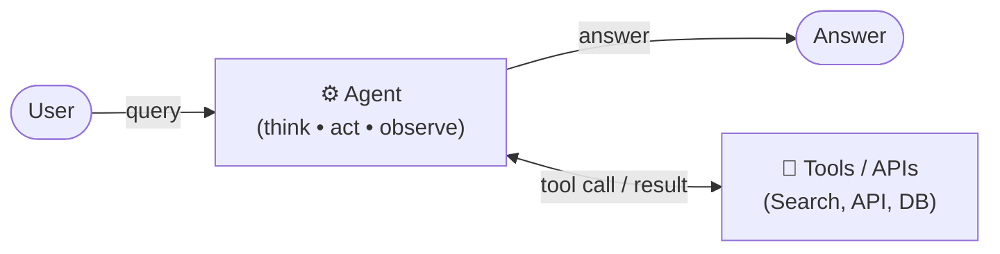
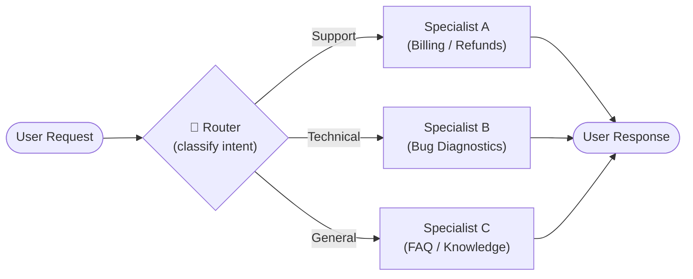
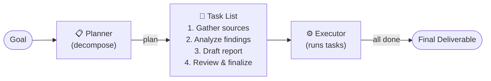
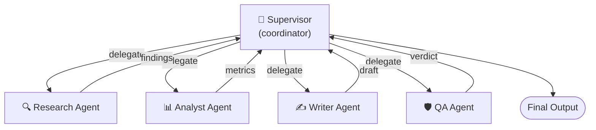
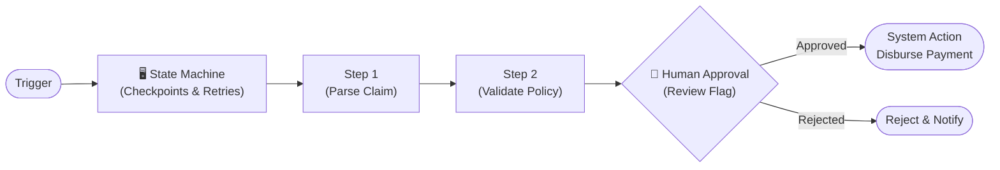

# 🤖 6 AI Agent Patterns

> **Category**: `architecture` · **Last Updated**: `2026-10-25` · **Difficulty**: `Intermediate`

---

## TL;DR

Modern production AI applications rely on six fundamental agentic architectural patterns: **Tool-Using Agent**, **Router / Dispatcher**, **Planner + Executor**, **Reflection**, **Supervisor Team**, and **Workflow + HITL (Human-in-the-Loop)**. Selecting the right pattern balances autonomous flexibility, execution latency, cost, and reliability.

---

## 📋 Overview

Building with Large Language Models has evolved from simple prompt-response interactions to structured agent architectures that reason, call external APIs, self-correct, collaborate, and integrate human governance.

| # | Pattern | Core Mechanism | Primary Benefit | Best For |
|---|---------|----------------|-----------------|----------|
| 1 | **Tool-Using Agent** | Think-Act-Observe (ReAct) loop calling tools/APIs | Extends model capabilities with real-time data & actions | Copilots, support bots, CLI tools |
| 2 | **Router / Dispatcher** | Intent classification directing queries to specialized handlers | Optimizes cost, speed, and accuracy per domain | Triage, service desks, IT ticketing |
| 3 | **Planner + Executor** | Decomposes high-level goals into an ordered task list | Solves complex, multi-step tasks without wandering | Research reports, onboarding, migrations |
| 4 | **Reflection** | Generator-Evaluator critique and refinement loop | Eliminates hallucinations and improves code/prose quality | Code generation, content writing, analysis |
| 5 | **Supervisor Team** | Central coordinator managing a pool of specialist agents | Multi-domain collaboration with distinct persona roles | Deep analysis, comprehensive review pipelines |
| 6 | **Workflow + HITL** | Durable state machine with human checkpoint approvals | Enforces safety, compliance, and deterministic recovery | Claims, procurement, regulatory compliance |

---

## 1. ⚙️ Tool-Using Agent

### Core Mechanism
The agent follows a **Think → Act → Observe** (ReAct) loop. Given a user query, the LLM determines whether it needs additional information or external actions. It emits structured tool calls (e.g., search, database lookups, calculation), receives the environment's observation, and reasons again until it can formulate the final answer.



- **Best For**: Conversational copilots, IT support bots, interactive data query assistants, coding agent terminal runners.
- **Strengths**: High adaptability; retrieves up-to-date facts; performs real-world actions.
- **Trade-offs**: Non-deterministic tool selection; vulnerable to infinite tool loops without depth caps.

---

## 2. 🔀 Router / Dispatcher

### Core Mechanism
Acts as an intelligent front-door traffic controller. An initial classifier (lightweight LLM, semantic embedding matcher, or rule set) categorizes incoming intent and immediately routes the request to a dedicated specialist agent, optimized prompt, or deterministic function.



- **Best For**: Customer service triage, IT helpdesks, omnichannel support routing, multi-lingual receptionists.
- **Strengths**: Ultra-low latency and reduced token costs by using small routing models; keeps specialist prompts lean.
- **Trade-offs**: Single point of failure if initial classification is misdirected; handles multi-intent queries poorly without sub-routing.

---

## 3. 📋 Planner + Executor

### Core Mechanism
Decouples strategic problem decomposition from tactical execution. A **Planner** analyzes the broad goal and generates an explicit, ordered task list (or DAG). An **Executor** then takes each task sequentially or in parallel, updates progress state, and passes results to subsequent steps until all items are checked off.



- **Best For**: Automated research reports, complex data extraction, data migration tasks, employee or customer onboarding workflows.
- **Strengths**: Transparent auditability; avoids context drift on long-horizon tasks; easy to resume upon failure.
- **Trade-offs**: Upfront latency while planning; brittle if initial plan misses unforeseen obstacles.

---

## 4. ✏️ Reflection

### Core Mechanism
Implements a dual-agent self-correction loop consisting of a **Generator** and an **Evaluator (Critic)**. The Generator drafts the artifact (code, document, answer). The Evaluator tests and critiques it against specific rubrics, unit tests, or criteria. If the score falls below threshold, structured critique is fed back for iterative revision.

```mermaid
graph LR
    Task([Task]) --> Generator["✏️ Generator\n(drafts)"]
    Generator --> Draft["📄 Draft (v1, v2)"]
    Draft --> Evaluator{"🔍 Evaluator\n(score + critique)"}
    Evaluator -->|score >= 0.90 (pass)| Final([Final Output])
    Evaluator -->|feedback: add citations / fix bug| Generator
```

- **Best For**: Autonomous code generation (TDD loops), technical editing, complex math reasoning, compliance validation.
- **Strengths**: Dramatically higher output accuracy and fewer hallucinations; mimics human revision.
- **Trade-offs**: Multiplies token consumption and inference latency proportional to iteration loops.

---

## 5. 👑 Supervisor Team

### Core Mechanism
A hierarchical multi-agent coordination architecture. A central **Supervisor** (manager) holds the overarching context and delegates sub-tasks to a fleet of specialized subordinate agents (e.g., Researcher, Analyst, Writer, QA). The specialists report their findings back to the supervisor, who synthesizes the final output or requests follow-ups.



- **Best For**: Deep competitive intelligence, comprehensive codebase refactoring, end-to-end publishing pipelines, multi-perspective policy analysis.
- **Strengths**: Clear role division; specialized domain prompts; scalable parallelism.
- **Trade-offs**: High token orchestration overhead; risk of supervisor becoming a bottleneck or misinterpreting sub-agent outputs.

---

## 6. 👥 Workflow + HITL (Human-in-the-Loop)

### Core Mechanism
Combines deterministic state machines with LLM steps and mandatory human approval gates. Operates with durable execution checkpoints, state persistence at every transition, and automated retry policies. Irreversible or high-stakes actions (issuing refunds, publishing content, database drops) are paused until a human operator clicks approve or provides guidance.



- **Best For**: Insurance claims processing, loan underwriting, financial transactions, HR policy actions, medical decision support.
- **Strengths**: Maximum safety, regulatory compliance, zero runaway autonomous side-effects, full audit logging.
- **Trade-offs**: Bounded by human availability and response latency; requires UI for reviews and state persistence infrastructure (e.g., Temporal, LangGraph).

---

## 🗺️ Pattern Selection Decision Matrix

| Requirement / Constraint | Recommended Pattern |
|---|---|
| Need interactive Q&A that looks up facts or calls APIs | **Tool-Using Agent** |
| High incoming traffic with diverse, distinct user intents | **Router / Dispatcher** |
| Long-running task with multiple distinct milestones | **Planner + Executor** |
| Mission-critical code or copy requiring near-zero errors | **Reflection** |
| Complex project needing distinct domain viewpoints (e.g., Legal + Tech + Finance) | **Supervisor Team** |
| Financial, medical, or irreversible actions requiring compliance sign-off | **Workflow + HITL** |

---

## ⚠️ Anti-Patterns vs. Best Practices

| ❌ Anti-Pattern | ✅ Best Practice |
|---|---|
| **One Agent to Rule Them All**: Giving a single agent 40 tools and a 2,000-line prompt. | Use a **Router** or **Supervisor Team** to segment into focused, single-purpose specialists. |
| **Ungoverned Execution**: Letting autonomous agents charge credit cards or deploy to production without approval. | Place a **Workflow + HITL** human checkpoint in front of any irreversible side effect. |
| **Unbounded Reflection**: Running evaluator-generator critique loops without loop limits. | Hard-cap reflection to 3–5 iterations and set an explicit score passing threshold. |
| **Stateless Long Chains**: Executing 20-step tasks in memory without persistence. | Persist state checkpoints after every task so failed executions can resume cleanly. |

---

## 🔗 Related Topics

- [Backend Architecture & Folder Structure](backend-architecture.md)
- [Microservices Architecture](microservices.md)
- [Event-Driven Architecture](event-driven.md)
- [AI Agents & Skills Hub](../github_repos/ai-agents-skills/README.md)

---

*← Back to [Architecture](./README.md) · [Root Index](../README.md)*
