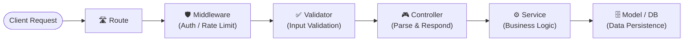

# Backend Architecture & Folder Structure

> **Category**: `architecture` · **Last Updated**: `2026-10-25` · **Difficulty**: `Beginner`

---

## TL;DR

Organize backend applications using a layered (n-tier) architecture that enforces separation of concerns. Every layer has a single responsibility, processing requests through a predictable unidirectional flow: **Route → Controller → Service → Database**.

---

## 📋 Overview

- **What**: A modular, layer-based directory structure separating transport (routes/controllers), business logic (services), and data persistence (models).
- **Why**: Prevents bloated "fat controllers", decouples business logic from HTTP frameworks, makes unit testing straightforward, and eases onboarding.
- **When**: Standard RESTful APIs, MVC/monolith backends, or microservice service templates (Node.js/Express/Fastify, Python/FastAPI, Go, etc.).

---

## 📁 Recommended Folder Structure

```
backend/
├── config/         # App & database configuration
├── routes/         # API endpoints
├── controllers/    # Handle requests & responses
├── services/       # Business logic
├── models/         # Database schemas
├── middleware/     # Authentication & request processing
├── validators/     # Input validation
└── utils/          # Reusable helper functions
```

### Layer Responsibilities

| Directory | Name | Responsibility | Examples |
|-----------|------|----------------|----------|
| 📁 `config/` | Configuration | App environments, database connection pools, third-party API keys | `db.ts`, `env.ts` |
| 🛣️ `routes/` | Routes | Maps URL paths and HTTP methods to middlewares and controllers | `user.routes.ts` |
| 🎮 `controllers/` | Controllers | Parses request inputs, calls services, and returns HTTP responses | `user.controller.ts` |
| ⚙️ `services/` | Services | Houses core business logic, domain calculations, and transaction orchestration | `user.service.ts` |
| 🗄️ `models/` | Models | Database schemas, ORM/ODM models, and data types | `user.model.ts` |
| 🛡️ `middleware/` | Middleware | Authentication, role checks, rate limiting, request logging, error handling | `auth.middleware.ts` |
| ✅ `validators/` | Validators | Request schema validation (body, params, query) using Zod, Joi, or Pydantic | `user.schema.ts` |
| 🔧 `utils/` | Utilities | Pure, reusable helper functions and formatting routines | `date-formatter.ts` |

---

## 💡 Request Flow

Incoming HTTP requests move through each layer sequentially:



```
Route ──▶ Controller ──▶ Service ──▶ Database
```

1. **Route**: Matches the endpoint (`POST /api/v1/orders`).
2. **Middleware & Validator**: Authenticates the token and validates the payload shape.
3. **Controller**: Extracts `req.body`, calls the corresponding service method, and formats the response (`res.status(201).json(...)`).
4. **Service**: Applies business rules (e.g., check inventory, calculate discounts, charge payment, save order).
5. **Database / Model**: Executes the query against persistent storage.

---

## ⚠️ Anti-Patterns vs. Best Practices

| ❌ Anti-Pattern | ✅ Better Approach |
|-----------------|-------------------|
| **Fat Controllers**: Putting SQL queries and business logic inside controller functions. | Keep controllers "thin"; delegate all domain logic to services. |
| **Direct DB calls from routes**: Writing handler logic directly in route files. | Separate route definitions (`routes/`) from execution handlers (`controllers/`). |
| **Scattered Validation**: Validating request shapes inside service or database logic. | Validate early at the boundary using schema validators (`validators/`) before reaching controllers. |
| **Circular Dependencies**: Services calling controllers or routes. | Enforce unidirectional dependency: `Route → Controller → Service → Model`. |
| **Premature Over-Engineering**: Creating 15 abstract layers for a 2-route microservice. | Start simple; introduce additional layers (e.g., repositories, event publishers) only when the application demands them. |

---

## ⚠️ Guiding Note

> There's no single perfect folder structure. Start simple and introduce additional layers when your application needs them.

---

## 🔗 Related Topics

- [AI Agent Patterns](ai-agent-patterns.md)
- [Microservices Architecture](microservices.md)
- [Event-Driven Architecture](event-driven.md)

---

*← Back to [Architecture](./README.md) · [Root Index](../README.md)*
