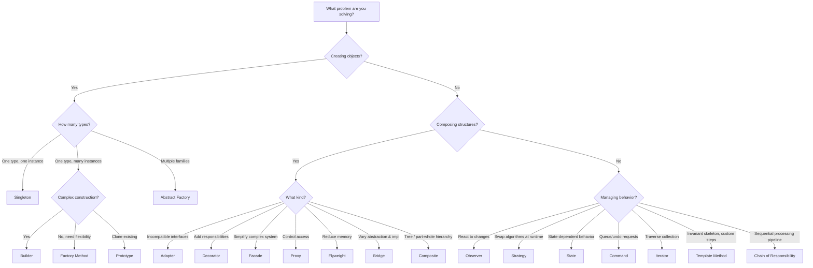

# 🎨 Design Patterns

> Reusable solutions to common software design problems, organized by the Gang of Four (GoF) classification.

---

## 📋 Overview

Design patterns are essential tools that offer **reusable solutions to common problems** in software design. They provide a proven framework for writing efficient, maintainable, and scalable code. By leveraging these patterns, developers can streamline the development process and improve code readability and reliability.

Design patterns are categorized into three main types based on their purpose:

| Category | Purpose | Count |
|---|---|---|
| 🏗️ **Creational** | Deal with object creation mechanisms | 5 |
| 🧱 **Structural** | Focus on object composition and structure | 7 |
| 🔄 **Behavioral** | Manage object interaction and communication | 7 |

---

## 🌟 15 Must-Know Design Patterns

A quick-reference guide to the fifteen foundational design patterns that every software engineer should know:

| # | Pattern | Type | What It Does (Core Idea) | Path |
|---|---|---|---|---|
| 1 | **Singleton** | 🏗️ Creational | **One shared instance, ever**: Ensures a class has only one instance with a global point of access. | [singleton.md](singleton.md) |
| 2 | **Factory Method** | 🏗️ Creational | **Decides which class to create**: Defines an interface for creating objects, letting subclasses decide which class to instantiate. | [factory-method.md](factory-method.md) |
| 3 | **Builder** | 🏗️ Creational | **Builds an object step by step**: Constructs complex objects step-by-step and produces different representations. | [builder.md](builder.md) |
| 4 | **Adapter** | 🧱 Structural | **Fits one interface to another**: Converts one interface into another that clients expect (e.g., square to round). | [adapter.md](adapter.md) |
| 5 | **Decorator** | 🧱 Structural | **Wraps an object to add behavior**: Attaches responsibilities to objects dynamically without subclassing. | [decorator.md](decorator.md) |
| 6 | **Facade** | 🧱 Structural | **Simple front for a subsystem**: Provides a unified, high-level interface to a complex set of subsystem interfaces. | [facade.md](facade.md) |
| 7 | **Proxy** | 🧱 Structural | **Controls access to an object**: Provides a placeholder or surrogate to control and manage access to another object. | [proxy.md](proxy.md) |
| 8 | **Composite** | 🧱 Structural | **Treats parts and wholes alike**: Composes objects into tree structures to represent part-whole hierarchies uniformly. | [composite.md](composite.md) |
| 9 | **Observer** | 🔄 Behavioral | **Notifies dependents on change**: Defines a subscription mechanism to notify multiple objects about any events that happen to the subject. | [observer.md](observer.md) |
| 10 | **Strategy** | 🔄 Behavioral | **Swaps algorithms at runtime**: Defines a family of algorithms, encapsulates each one, and makes them interchangeable. | [strategy.md](strategy.md) |
| 11 | **Command** | 🔄 Behavioral | **Wraps a request as an object**: Encapsulates a request as an object with execution, parameters, and undo support. | [command.md](command.md) |
| 12 | **Iterator** | 🔄 Behavioral | **Walks items, hides internals**: Traverses elements of a collection sequentially without exposing its underlying structure. | [iterator.md](iterator.md) |
| 13 | **State** | 🔄 Behavioral | **Behavior changes with state**: Allows an object to alter its behavior when its internal state changes. | [state.md](state.md) |
| 14 | **Template Method** | 🔄 Behavioral | **Fixed skeleton, custom steps**: Defines an algorithm's skeleton in a base class, deferring specific steps to subclasses. | [template-method.md](template-method.md) |
| 15 | **Chain of Responsibility** | 🔄 Behavioral | **Passes requests down a chain**: Passes requests along a chain of handlers until one handles it or it completes. | [chain-of-responsibility.md](chain-of-responsibility.md) |

---

## 🏗️ Creational Patterns

> Deal with object creation mechanisms, hiding instantiation details and making the system independent of how its objects are created.

| # | Pattern | Description | Difficulty | Path |
|---|---|---|---|---|
| 1 | Singleton | Ensures a class has only one instance with global access | Beginner | [singleton.md](singleton.md) |
| 2 | Factory Method | Defines interface for creating objects, letting subclasses decide | Intermediate | [factory-method.md](factory-method.md) |
| 3 | Abstract Factory | Creates families of related objects without concrete classes | Advanced | [abstract-factory.md](abstract-factory.md) |
| 4 | Builder | Separates complex object construction from representation | Intermediate | [builder.md](builder.md) |
| 5 | Prototype | Creates new objects by cloning existing ones | Intermediate | [prototype.md](prototype.md) |

---

## 🧱 Structural Patterns

> Focus on how classes and objects can be combined to form larger, more flexible, and efficient structures.

| # | Pattern | Description | Difficulty | Path |
|---|---|---|---|---|
| 6 | Adapter | Converts one interface into another that clients expect | Intermediate | [adapter.md](adapter.md) |
| 7 | Bridge | Decouples abstraction from implementation | Advanced | [bridge.md](bridge.md) |
| 8 | Decorator | Adds behavior to objects dynamically without altering structure | Intermediate | [decorator.md](decorator.md) |
| 9 | Facade | Provides a simplified interface to a complex subsystem | Beginner | [facade.md](facade.md) |
| 10 | Flyweight | Reduces memory usage by sharing common data among objects | Advanced | [flyweight.md](flyweight.md) |
| 11 | Proxy | Controls and manages access to another object | Intermediate | [proxy.md](proxy.md) |
| 12 | Composite | Treats individual objects and compositions of objects uniformly | Intermediate | [composite.md](composite.md) |

---

## 🔄 Behavioral Patterns

> Manage responsibilities and complex control flows between objects, defining how objects interact and communicate.

| # | Pattern | Description | Difficulty | Path |
|---|---|---|---|---|
| 13 | Observer | Defines one-to-many dependency for automatic state notifications | Intermediate | [observer.md](observer.md) |
| 14 | Strategy | Defines a family of interchangeable algorithms | Intermediate | [strategy.md](strategy.md) |
| 15 | State | Allows an object to alter behavior when internal state changes | Advanced | [state.md](state.md) |
| 16 | Command | Encapsulates a request as an object with undo/queue support | Intermediate | [command.md](command.md) |
| 17 | Iterator | Accesses collection elements sequentially without exposing internals | Beginner | [iterator.md](iterator.md) |
| 18 | Template Method | Defines algorithm skeleton in a superclass, steps in subclasses | Beginner | [template-method.md](template-method.md) |
| 19 | Chain of Responsibility | Passes requests along a chain of handlers until processed | Intermediate | [chain-of-responsibility.md](chain-of-responsibility.md) |

---

## 🗺️ Pattern Selection Guide

---

## 📚 References

- [Refactoring Guru — Design Patterns](https://refactoring.guru/design-patterns)
- [GeeksforGeeks — Design Patterns Use Cases](https://www.geeksforgeeks.org/system-design/design-patterns-use-cases/)
- [Gang of Four — Design Patterns: Elements of Reusable Object-Oriented Software (1994)](https://en.wikipedia.org/wiki/Design_Patterns)

---

*← Back to [Root Index](../README.md)*
