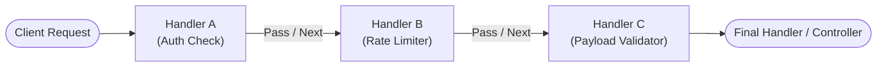

# Chain of Responsibility Pattern

> **Category**: `design-patterns / behavioral` · **Last Updated**: `2026-10-25` · **Difficulty**: `Intermediate`

---

## TL;DR

The Chain of Responsibility pattern **passes requests along a chain of potential handlers**. Upon receiving a request, each handler decides either to process the request or to pass it along to the next handler in the chain.

> **Infographic Summary**: *Passes requests down a chain.* (A request enters a sequential pipeline: Handler A evaluates, passes to Handler B, which passes to Handler C until a handler resolves or terminates it).

---

## 📋 Overview

- **What**: A behavioral pattern that decouples the sender of a request from its potential receivers by chaining receiver objects together.
- **Why**: Allows adding, removing, or reordering processing steps dynamically without changing the sender's code or coupling clients to specific handlers.
- **When**: Web request middleware pipelines (authentication, CORS, rate-limiting, logging), customer support escalation tiers, and UI event bubbling.

---

## 📐 Syntax / Visual Diagram



```
[ Request ] ──▶ [ Handler A ] ──(pass)──▶ [ Handler B ] ──(pass)──▶ [ Handler C ] ──▶ [ Response ]
```

---

## 💻 Code Examples

### Python — HTTP Request Processing Pipeline

```python
from abc import ABC, abstractmethod
from typing import Optional

class Request:
    def __init__(self, path: str, token: str, is_admin: bool, body: dict):
        self.path = path
        self.token = token
        self.is_admin = is_admin
        self.body = body

# Base Handler Interface
class Handler(ABC):
    def __init__(self, next_handler: Optional["Handler"] = None):
        self._next_handler = next_handler

    def set_next(self, handler: "Handler") -> "Handler":
        self._next_handler = handler
        return handler

    @abstractmethod
    def handle(self, request: Request) -> bool:
        if self._next_handler:
            return self._next_handler.handle(request)
        return True

# Concrete Handler 1: Authentication
class AuthHandler(Handler):
    def handle(self, request: Request) -> bool:
        if request.token != "valid-jwt-token":
            print("🚫 AuthHandler: Invalid or missing authentication token!")
            return False
        print("✅ AuthHandler: Token authenticated.")
        return super().handle(request)

# Concrete Handler 2: Admin Authorization
class RoleHandler(Handler):
    def handle(self, request: Request) -> bool:
        if "/admin" in request.path and not request.is_admin:
            print("🚫 RoleHandler: Admin privileges required for this route!")
            return False
        print("✅ RoleHandler: Role authorization verified.")
        return super().handle(request)

# Concrete Handler 3: Rate Limiting
class RateLimitHandler(Handler):
    def __init__(self, limit: int, next_handler: Optional[Handler] = None):
        super().__init__(next_handler)
        self.limit = limit
        self.requests_count = 0

    def handle(self, request: Request) -> bool:
        self.requests_count += 1
        if self.requests_count > self.limit:
            print("🚫 RateLimitHandler: Rate limit exceeded (429 Too Many Requests)!")
            return False
        print("✅ RateLimitHandler: Request within rate limits.")
        return super().handle(request)

# Constructing the Chain
auth = AuthHandler()
role = RoleHandler()
rate = RateLimitHandler(limit=2)

auth.set_next(role).set_next(rate)

# Testing the Pipeline
req1 = Request("/admin/metrics", token="valid-jwt-token", is_admin=True, body={})
print("--- Sending Valid Admin Request ---")
auth.handle(req1)

req2 = Request("/admin/metrics", token="invalid-token", is_admin=True, body={})
print("\n--- Sending Invalid Token Request ---")
auth.handle(req2)
```

---

## ⚠️ Anti-Patterns

| ❌ Anti-Pattern | ✅ Better Approach |
|---|---|
| Endless chains where no handler processes the request and it silently drops | Always configure a terminal default handler to handle unhandled requests gracefully. |
| Deeply coupled handlers that reference sibling handler types | Each handler should only know its successor's generic `Handler` interface, not concrete types. |
| Creating circular chain loops | Ensure chains are strictly linear directed acyclic graphs (DAGs). |

---

## 🌍 Real-World Use Cases

| Use Case | Description |
|---|---|
| **Web Middlewares** | Express.js, Django, Fastify `app.use(middleware)` handling CORS, Auth, Gzip, and Logging. |
| **GUI Event Bubbling** | DOM events propagating from child button → parent container → document body. |
| **Technical Support** | Tier 1 (Chatbot) → Tier 2 (Human Tech Rep) → Tier 3 (Core Engineer) escalation. |
| **Logger Filters** | `DEBUG → INFO → WARN → ERROR` logging appenders routing messages to console, disk, or Sentry. |

---

## 🔗 Related Topics

- [Command](command.md) — Can pass command objects down a chain of handlers
- [Decorator](decorator.md) — Both rely on recursive execution, but Decorator executes all wrappers, whereas Chain of Responsibility can break early
- [Composite](composite.md) — Often combined when event bubbling propagates up a tree hierarchy

---

## 📚 References

- [Refactoring Guru — Chain of Responsibility](https://refactoring.guru/design-patterns/chain-of-responsibility)
- [SourceMaking — Chain of Responsibility Pattern](https://sourcemaking.com/design_patterns/chain_of_responsibility)

---

*← Back to [Design Patterns](./README.md) · [Root Index](../README.md)*
