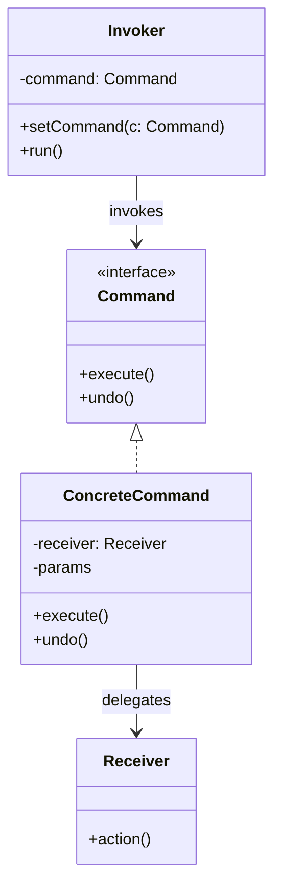

# Command Pattern

> **Category**: `design-patterns / behavioral` · **Last Updated**: `2026-10-25` · **Difficulty**: `Intermediate`

---

## TL;DR

The Command pattern **encapsulates a request as an independent object**, thereby letting you parameterize clients with different requests, queue or log requests, and support undoable operations.

> **Infographic Summary**: *Wraps a request as an object.* (Invoker triggers `execute()` on a Command object, which calls the target action on the Receiver).

---

## 📋 Overview

- **What**: A behavioral pattern that decouples the object that invokes an operation (`Invoker`) from the one that knows how to perform it (`Receiver`).
- **Why**: Allows commands to be passed as arguments, scheduled in job queues, serialized over networks, stored in history stacks, and undone/redone cleanly.
- **When**: GUI action buttons, macro recording, transactional systems with rollback/undo, task schedulers, and job queues.

---

## 📐 Syntax / Visual Diagram



```
[ Client ] ──▶ [ Invoker (Button) ] ──▶ [ Command Object ] ──▶ [ Receiver (Light / DB) ]
```

---

## 💻 Code Examples

### Python — Smart Home Switch & Undo Support

```python
from abc import ABC, abstractmethod

# Receiver
class Light:
    def __init__(self, location: str):
        self.location = location
        self.is_on = False

    def turn_on(self):
        self.is_on = True
        print(f"💡 {self.location} light is ON")

    def turn_off(self):
        self.is_on = False
        print(f"🌑 {self.location} light is OFF")

# Command Interface
class Command(ABC):
    @abstractmethod
    def execute(self) -> None:
        pass

    @abstractmethod
    def undo(self) -> None:
        pass

# Concrete Commands
class TurnOnCommand(Command):
    def __init__(self, light: Light):
        self.light = light

    def execute(self) -> None:
        self.light.turn_on()

    def undo(self) -> None:
        self.light.turn_off()

class TurnOffCommand(Command):
    def __init__(self, light: Light):
        self.light = light

    def execute(self) -> None:
        self.light.turn_off()

    def undo(self) -> None:
        self.light.turn_on()

# Invoker (Remote Control with Undo History)
class RemoteControl:
    def __init__(self):
        self._history: list[Command] = []

    def press_button(self, command: Command):
        command.execute()
        self._history.append(command)

    def press_undo(self):
        if self._history:
            cmd = self._history.pop()
            print("↩️ Undoing last action...")
            cmd.undo()
        else:
            print("Nothing to undo.")

# Usage
living_room_light = Light("Living Room")
remote = RemoteControl()

on_cmd = TurnOnCommand(living_room_light)
off_cmd = TurnOffCommand(living_room_light)

remote.press_button(on_cmd)   # Output: 💡 Living Room light is ON
remote.press_button(off_cmd)  # Output: 🌑 Living Room light is OFF
remote.press_undo()           # Output: ↩️ Undoing last action... 💡 Living Room light is ON
```

---

## ⚠️ Anti-Patterns

| ❌ Anti-Pattern | ✅ Better Approach |
|---|---|
| Hardcoding receiver operations directly inside UI buttons / event handlers | Wrap operations in Command objects to decouple UI from business logic. |
| Making commands hold heavy duplicate copies of receiver state | Store only state deltas or parameter snapshots needed to reverse the operation. |
| Creating dozens of trivial commands that only forward a single parameterless method | Consider using Python first-class functions / closures (`lambda: receiver.action()`) for simple callbacks. |

---

## 🌍 Real-World Use Cases

| Use Case | Description |
|---|---|
| **Text Editors / IDEs** | Undo/Redo stacks in VS Code, Word, or Photoshop (`Ctrl+Z` / `Ctrl+Y`). |
| **GUI Buttons & Menus** | Reusable `Action` objects bound across toolbar buttons, keyboard shortcuts, and context menus. |
| **Job & Task Queues** | Serializing commands to Celery, BullMQ, or SQS for asynchronous background workers. |
| **Database Transactions** | Executing write operations that can be rolled back via an `undo()` / compensator ledger. |

---

## 🔗 Related Topics

- [Strategy](strategy.md) — Solves algorithmic variations; Command models action requests as objects
- [Chain of Responsibility](chain-of-responsibility.md) — Can pass command objects down a chain of handlers
- [Observer](observer.md) — Connects event emitters with command receivers

---

## 📚 References

- [Refactoring Guru — Command Pattern](https://refactoring.guru/design-patterns/command)
- [SourceMaking — Command Design Pattern](https://sourcemaking.com/design_patterns/command)

---

*← Back to [Design Patterns](./README.md) · [Root Index](../README.md)*
