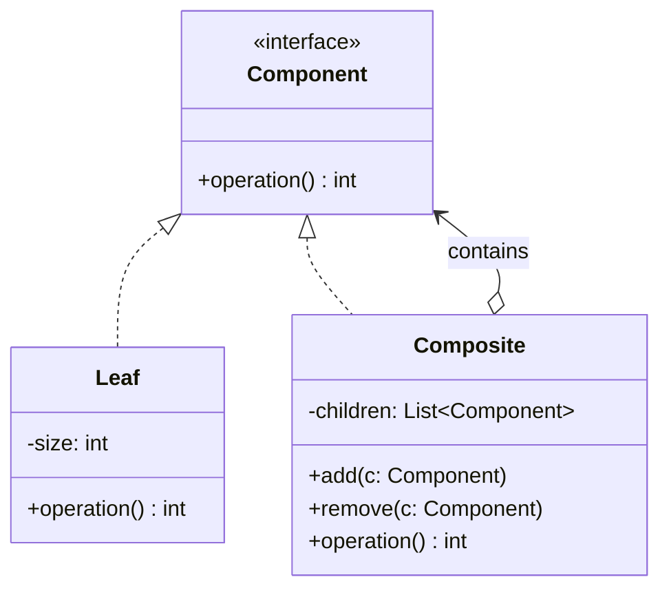

# Composite Pattern

> **Category**: `design-patterns / structural` · **Last Updated**: `2026-10-25` · **Difficulty**: `Intermediate`

---

## TL;DR

The Composite pattern **treats individual objects and compositions of objects uniformly**. It composes objects into tree structures to represent part-whole hierarchies, allowing clients to treat single components and groups of components identically.

> **Infographic Summary**: *Treats parts and wholes alike.* (`getSize()` on a 9 KB folder computes size across 4 KB files and nested 5 KB folders).

---

## 📋 Overview

- **What**: A structural design pattern that lets you compose objects into tree structures and then work with these structures as if they were individual objects.
- **Why**: Eliminates complex conditional checks (`if isinstance(item, Folder) ... else ...`) when operating over recursive or nested hierarchical data.
- **When**: When your model can be represented as an object tree (e.g., file systems, UI view hierarchies, organizational charts, nested menus, product bundles).

---

## 📐 Syntax / Visual Diagram



```
               [ Folder: Root (9 KB) ]
                     /          \
        [ File: doc.txt (4 KB) ]   [ Folder: Sub (5 KB) ]
                                      /              \
                         [ File: a.png (2 KB) ]  [ File: b.png (3 KB) ]
```

---

## 💻 Code Examples

### Python — File System Hierarchy

```python
from abc import ABC, abstractmethod

# Component
class FileSystemItem(ABC):
    @abstractmethod
    def get_size(self) -> int:
        pass

    @abstractmethod
    def display(self, indent: int = 0) -> None:
        pass

# Leaf
class File(FileSystemItem):
    def __init__(self, name: str, size: int):
        self.name = name
        self.size = size

    def get_size(self) -> int:
        return self.size

    def display(self, indent: int = 0) -> None:
        print(f"{'  ' * indent}📄 {self.name} ({self.size} KB)")

# Composite
class Directory(FileSystemItem):
    def __init__(self, name: str):
        self.name = name
        self.children: list[FileSystemItem] = []

    def add(self, item: FileSystemItem) -> "Directory":
        self.children.append(item)
        return self

    def remove(self, item: FileSystemItem) -> None:
        self.children.remove(item)

    def get_size(self) -> int:
        return sum(child.get_size() for child in self.children)

    def display(self, indent: int = 0) -> None:
        print(f"{'  ' * indent}📁 {self.name}/ (total: {self.get_size()} KB)")
        for child in self.children:
            child.display(indent + 1)

# Usage
root = Directory("root")
root.add(File("doc.txt", 4))

sub = Directory("images")
sub.add(File("a.png", 2))
sub.add(File("b.png", 3))

root.add(sub)

# Treats parts and wholes identically
root.display()
print(f"\nTotal Root Size: {root.get_size()} KB") # Output: 9 KB
```

---

## ⚠️ Anti-Patterns

| ❌ Anti-Pattern | ✅ Better Approach |
|---|---|
| Exposing composite-only methods (`add`, `remove`) in the `Component` base interface | Keep the base interface focused on shared domain operations (`get_size()`), or declare `add()` with safe defaults/exceptions. |
| Type-checking leaves vs. composites in client code | Rely strictly on polymorphism; let the component handle recursion internally. |
| Inflexible two-way parent references causing memory leaks | Clean up parent pointers on component deletion or use weak references. |

---

## 🌍 Real-World Use Cases

| Use Case | Description |
|---|---|
| **DOM / UI Trees** | HTML Elements (`<div>` containing `<p>`, `<span>`, and nested `<div>`s) rendered as a single component. |
| **File Systems** | Folders containing files and nested directories responding uniformly to `du` or `rm -rf`. |
| **Graphics Editors** | Grouping multiple shapes into a single selection, moving and resizing them as one unit. |
| **Organization Charts** | Managers supervising individual contributors and subordinate managers, calculating department budgets. |

---

## 🔗 Related Topics

- [Decorator](decorator.md) — Enhances objects dynamically; Composite aggregates objects into trees
- [Iterator](iterator.md) — Used to traverse Composite trees without exposing internal structures
- [Visitor](strategy.md) — Executes operations across complex Composite tree nodes

---

## 📚 References

- [Refactoring Guru — Composite Pattern](https://refactoring.guru/design-patterns/composite)
- [SourceMaking — Composite Design Pattern](https://sourcemaking.com/design_patterns/composite)

---

*← Back to [Design Patterns](./README.md) · [Root Index](../README.md)*
