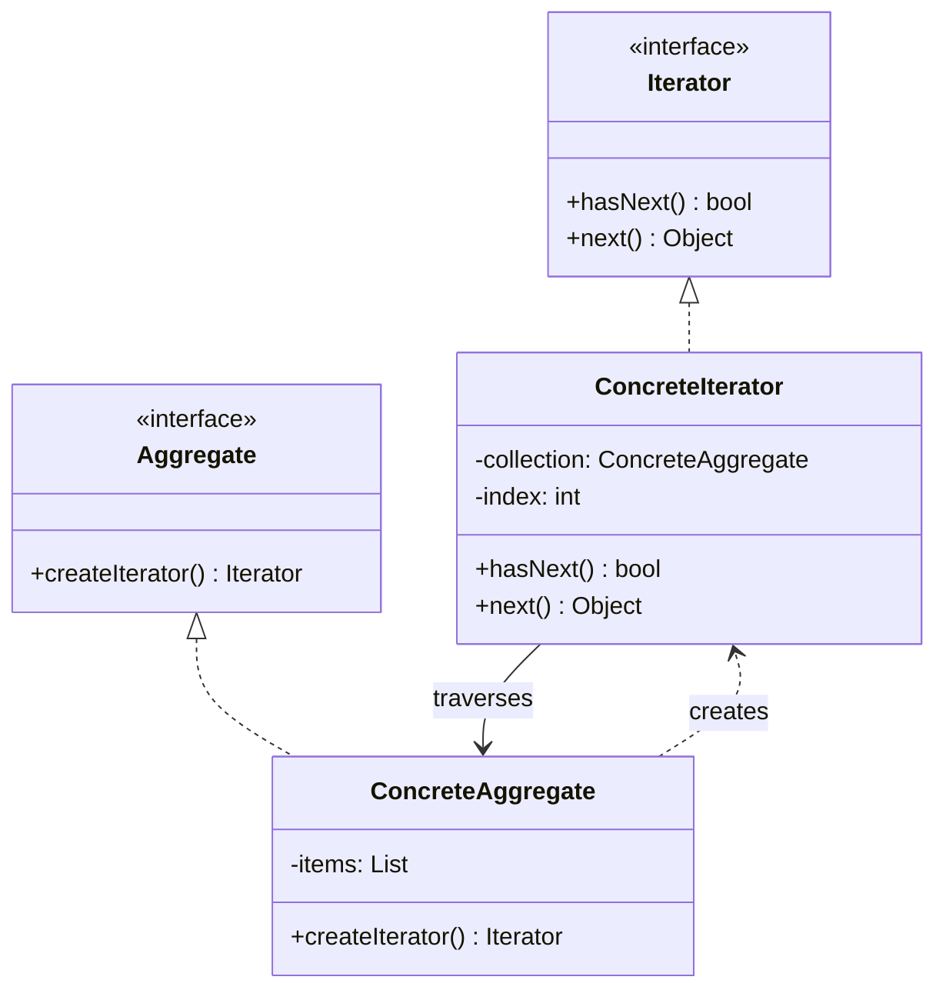

# Iterator Pattern

> **Category**: `design-patterns / behavioral` · **Last Updated**: `2026-10-25` · **Difficulty**: `Beginner`

---

## TL;DR

The Iterator pattern provides a way to **access the elements of an aggregate object sequentially without exposing its underlying representation** (whether an array, linked list, tree, or hash table).

> **Infographic Summary**: *Walks items, hides internals.* (`next()` retrieves the next element step-by-step without exposing how the collection stores elements).

---

## 📋 Overview

- **What**: A behavioral pattern that extracts traversal logic from collection data structures into standalone iterator objects.
- **Why**: Allows different traversal algorithms (forward, backward, depth-first, breadth-first, filtered) across the same collection simultaneously without cluttering the collection class.
- **When**: When your collection has a complex internal data structure and you want to hide its complexity from clients, or when you need multiple simultaneous traversals.

---

## 📐 Syntax / Visual Diagram



```
[ Collection: 8, 3, 5, 1, 9, 4 ]
               ▲
               │ next() ──▶ returns 3
      [ Iterator Pointer ]
```

---

## 💻 Code Examples

### Python — Custom Iterable Collection

```python
from collections.abc import Iterator, Iterable

class NumberRangeIterator(Iterator):
    def __init__(self, numbers: list[int]):
        self._numbers = numbers
        self._index = 0

    def __next__(self) -> int:
        if self._index < len(self._numbers):
            val = self._numbers[self._index]
            self._index += 1
            return val
        raise StopIteration

class NumberCollection(Iterable):
    def __init__(self, numbers: list[int]):
        self._numbers = numbers

    def __iter__(self) -> Iterator[int]:
        return NumberRangeIterator(self._numbers)

# Client Usage
dataset = NumberCollection([8, 3, 5, 1, 9, 4])

# Standard Python for-loop protocol (under the hood uses Iterator)
for num in dataset:
    print(f"Item: {num}")

# Manual traversal
iterator = iter(dataset)
print("First:", next(iterator))   # 8
print("Second:", next(iterator))  # 3
```

---

## ⚠️ Anti-Patterns

| ❌ Anti-Pattern | ✅ Better Approach |
|---|---|
| Directly indexing internal array buffers (`collection._data[i]`) across client code | Always use standard iterator interfaces (`for item in collection` or `iterator.next()`). |
| Mutating collection size during active iteration without snapshot protection | Raise concurrent modification errors or yield copies when modifying collections mid-loop. |
| Re-implementing iterators when language built-ins (e.g. Python generators `yield`, JS `Symbol.iterator`) already solve it | Use native generator functions for cleaner, memory-efficient lazy iteration. |

---

## 🌍 Real-World Use Cases

| Use Case | Description |
|---|---|
| **Python Generators** | `yield` syntax creating lazy streaming iterators for multi-gigabyte log files. |
| **Java Collections** | `java.util.Iterator` traversing `ArrayList`, `HashSet`, and `TreeMap` identically. |
| **Database Cursors** | Fetching batch chunks (`cursor.fetchmany(100)`) from remote relational databases. |
| **Graph Traversal** | BFS / DFS iterators traversing tree/graph structures node-by-node. |

---

## 🔗 Related Topics

- [Composite](composite.md) — Iterators are frequently used to recursively traverse Composite hierarchies
- [Factory Method](factory-method.md) — Collections use factory methods to instantiate compatible iterators

---

## 📚 References

- [Refactoring Guru — Iterator Pattern](https://refactoring.guru/design-patterns/iterator)
- [Python Documentation — Iterators and Generators](https://docs.python.org/3/tutorial/classes.html#iterators)

---

*← Back to [Design Patterns](./README.md) · [Root Index](../README.md)*
