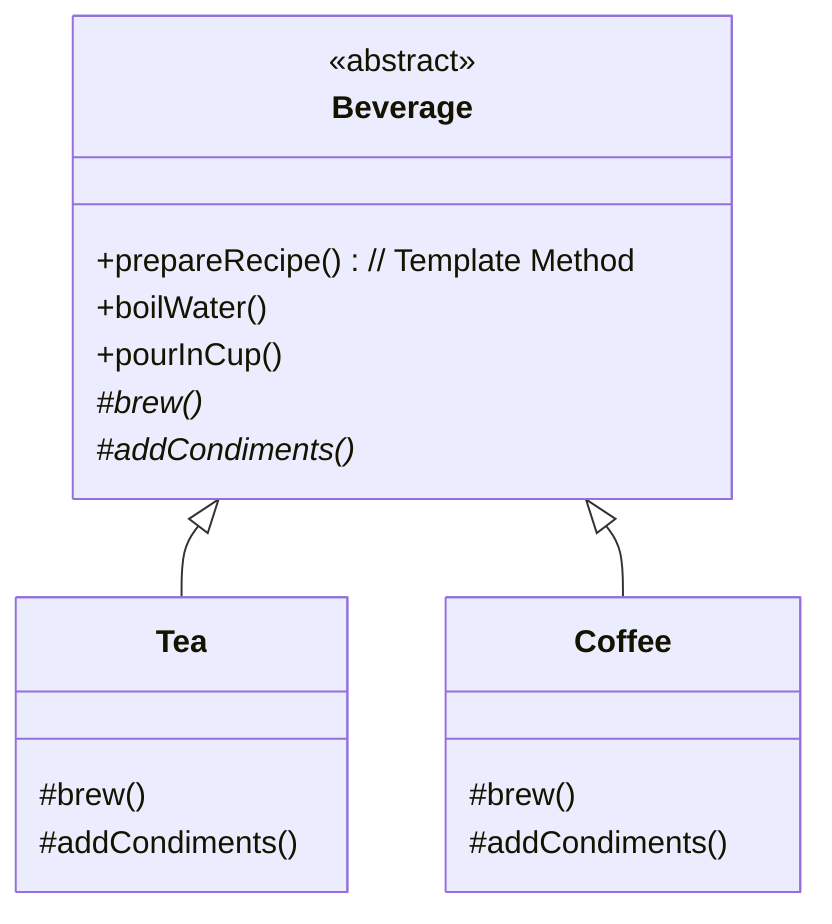

# Template Method Pattern

> **Category**: `design-patterns / behavioral` · **Last Updated**: `2026-10-25` · **Difficulty**: `Beginner`

---

## TL;DR

The Template Method pattern defines the **skeleton of an algorithm in a superclass** but lets subclasses **override specific steps of the algorithm without changing its overall structure**.

> **Infographic Summary**: *Fixed skeleton, custom steps.* (Base class `Beverage` defines the workflow `boil() → brew() → pour()`, while subclasses `Tea` and `Coffee` supply specific brewing implementations).

---

## 📋 Overview

- **What**: A behavioral pattern that turns a multi-step algorithm into a series of individual method calls inside a base class method (the "template method"), allowing subclasses to hook into individual steps.
- **Why**: Eliminates code duplication across similar workflows while enforcing invariant processing sequences.
- **When**: When multiple classes share almost identical execution steps with minor implementation differences, or when you want to let clients extend only particular steps of a larger algorithm.

---

## 📐 Syntax / Visual Diagram



```
[ Abstract Base Class ]
  ├── 1. boilWater()      (common)
  ├── 2. brew()           ◀── Subclass Customizes (Tea vs. Coffee)
  ├── 3. pourInCup()      (common)
  └── 4. addCondiments()  ◀── Subclass Customizes (Lemon vs. Sugar)
```

---

## 💻 Code Examples

### Python — Hot Beverage Preparation

```python
from abc import ABC, abstractmethod

# Abstract Base Class with Template Method
class Beverage(ABC):
    # The Template Method defines the fixed workflow skeleton
    def prepare_recipe(self) -> None:
        self.boil_water()
        self.brew()
        self.pour_in_cup()
        if self.customer_wants_condiments():
            self.add_condiments()

    def boil_water(self) -> None:
        print("♨️ Boiling clean filtered water")

    def pour_in_cup(self) -> None:
        print("☕ Pouring into ceramic mug")

    # Abstract steps customized by subclasses
    @abstractmethod
    def brew(self) -> None:
        pass

    @abstractmethod
    def add_condiments(self) -> None:
        pass

    # Optional "Hook" method (can be overridden)
    def customer_wants_condiments(self) -> bool:
        return True

# Concrete Subclass 1
class Tea(Beverage):
    def brew(self) -> None:
        print("🍃 Steeping delicate Earl Grey tea leaves")

    def add_condiments(self) -> None:
        print("🍋 Adding fresh lemon slice")

# Concrete Subclass 2
class Coffee(Beverage):
    def brew(self) -> None:
        print("🫘 Dripping dark roast arabica coffee grounds")

    def add_condiments(self) -> None:
        print("🥛 Adding steamed milk and sugar")

# Client Usage
print("--- Making Tea ---")
tea = Tea()
tea.prepare_recipe()

print("\n--- Making Coffee ---")
coffee = Coffee()
coffee.prepare_recipe()
```

---

## ⚠️ Anti-Patterns

| ❌ Anti-Pattern | ✅ Better Approach |
|---|---|
| Allowing subclasses to override the template method itself | Make the template method final/immutable; subclasses should only override step hooks. |
| Having 20+ abstract steps in the template method | Keep the skeleton concise; use default no-op hook implementations for non-mandatory steps. |
| Using Template Method when the algorithm structure changes radically between subclasses | Use the **Strategy** pattern instead, which injects interchangeable behavior via composition rather than inheritance. |

---

## 🌍 Real-World Use Cases

| Use Case | Description |
|---|---|
| **Data Mining Pipelines** | Invariant flow (`read_file() → parse_data() → analyze() → export_report()`) with format-specific subclasses for CSV, JSON, and XML. |
| **Testing Frameworks** | `setUp() → runTest() → tearDown()` lifecycle in JUnit / PyTest. |
| **Web Framework Middlewares** | Django / Rails controller filters executing pre-action, handler, and post-action sequences. |
| **Build & CI/CD Toolchains** | `checkout() → lint() → compile() → test() → deploy()` build pipelines. |

---

## 🔗 Related Topics

- [Strategy](strategy.md) — Changes algorithm via composition (delegation); Template Method changes steps via inheritance
- [Factory Method](factory-method.md) — Often called as a step inside template methods

---

## 📚 References

- [Refactoring Guru — Template Method](https://refactoring.guru/design-patterns/template-method)
- [SourceMaking — Template Method Pattern](https://sourcemaking.com/design_patterns/template_method)

---

*← Back to [Design Patterns](./README.md) · [Root Index](../README.md)*
