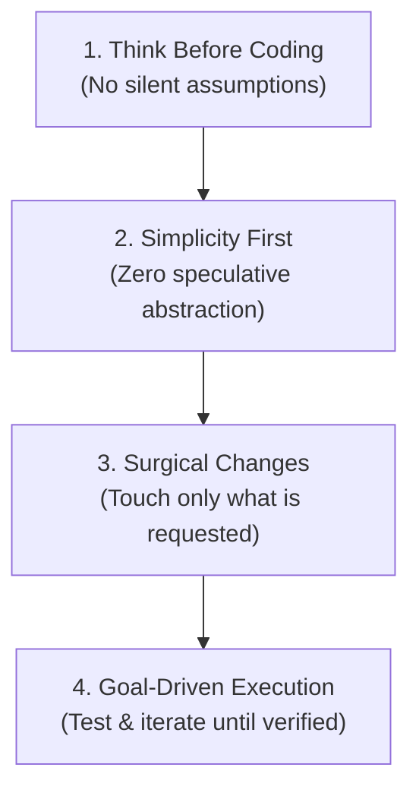

> 🔗 **GitHub Repository**: [multica-ai/andrej-karpathy-skills](https://github.com/multica-ai/andrej-karpathy-skills)

---

# 🧠 Andrej Karpathy's Agent Skills & Guidelines

> **Codified prompt engineering heuristics and operational constraints for AI coding agents.** Translates Andrej Karpathy's observations and advice regarding LLM coding failure modes into strict, actionable prompt guidelines and rulesets for Claude Code, Cursor, and universal agent runtimes.

[](https://opensource.org/licenses/MIT)
[](https://github.com/multica-ai/andrej-karpathy-skills)
[](#-supported-agent-runtimes)
[](#-core-principles)

---

## 🚀 Overview

Frontier LLMs possess vast technical knowledge, but when left unconstrained, they reliably fall into predictable traps: fabricating unrequested abstractions, making silent assumptions, executing destructive multi-file rewrites, and overcomplicating simple tasks.

**`andrej-karpathy-skills`** (originally crafted by Forrest Chang and maintained within the Multica organization) codifies Andrej Karpathy's insights into concrete rules, subagent skills, and `.cursorrules` / `CLAUDE.md` steering templates. It forces AI agents to think deliberately, minimize code volume, and verify changes systematically.

---

## 🔑 The Four Core Principles



| Principle | Guideline | Anti-Pattern Prevented |
|---|---|---|
| **1. Think Before Coding** | Surface architectural ambiguities, state trade-offs explicitly, and ask for clarification rather than assuming user intent. | Silently picking a library or design pattern that clashes with the existing architecture. |
| **2. Simplicity First** | Solve the immediate problem with the minimum viable code. Prefer standard language primitives over new frameworks or speculative wrappers. | Creating multi-layered factory classes or generic adapters for a one-off utility. |
| **3. Surgical Changes** | Edit only the lines directly necessary for the feature. Clean up temporary files, leave surrounding code intact, and respect project conventions. | Formatting entire files or refactoring unrelated helper methods while fixing a bug. |
| **4. Goal-Driven Execution** | Formulate a clear verification hypothesis, run test suites, inspect outputs, and iterate until proven correct. | Generating code and claiming success without running tests or inspecting error logs. |

---

## 📦 What the Repository Includes

```
andrej-karpathy-skills/
├── skills/
│   └── karpathy-guidelines/
│       └── SKILL.md                  # Modular skill definition for progressive disclosure
├── .cursor/
│   └── rules/
│       └── karpathy-guidelines.mdc   # Standard Cursor IDE ruleset
├── CLAUDE.md                         # Drop-in rules template for Claude Code
└── prompts/
    └── system-prompt-enhancer.md     # Universal steering prompt block
```

---

## 🤖 Supported Agent Runtimes

### 1. Claude Code Plugin / Skill Setup

Install via the Claude Code marketplace or universal skill managers:

```bash
# Claude Code marketplace
claude plugin marketplace add multica-ai/andrej-karpathy-skills
claude plugin install karpathy-guidelines@multica-ai

# Or universal skills CLI
npx skills add multica-ai/andrej-karpathy-skills
```

### 2. Cursor Configuration

Copy the rules file directly into your workspace:

```bash
mkdir -p .cursor/rules
cp .cursor/rules/karpathy-guidelines.mdc .cursor/rules/
```

### 3. Antigravity / Gemini CLI

Add to your `.agents/rules/` directory:

```bash
git clone https://github.com/multica-ai/andrej-karpathy-skills.git /tmp/aks
cp /tmp/aks/skills/karpathy-guidelines/SKILL.md .agents/rules/karpathy-discipline.md
```

---

## 🛠️ Prompt Steering Example

When integrated, the agent approaches engineering tasks with disciplined, structured steps:

```text
# User prompt:
"Add rate limiting to our auth endpoints."

# Disciplined Agent Response:
"Before writing code, here are two viable approaches based on your stack:
 1. Memory-based token bucket (zero new dependencies, resets on server restart).
 2. Redis-backed sliding window (persists across restarts, uses existing redis client).
 
 Given your production setup in config/redis.ts, I recommend approach #2. 
 Would you like me to proceed with Redis sliding window?"
```

---

## ⚠️ Key Anti-Patterns Eliminated

| ❌ Default Agent Tendency | ✅ Karpathy-Guided Behavior |
|---|---|
| Eagerly rewriting 200 lines of code for a 5-line fix | Modifying precisely the target function in-place |
| Adding speculative generic utilities "for the future" | Strictly adhering to YAGNI (You Aren't Gonna Need It) |
| Apologetic fluff and conversational filler | Outcome-first communication, clear trade-offs, and verified diffs |
| Halting after writing code without testing | Writing reproducing tests first and verifying terminal output |

---

## 🔗 Official Links

- **GitHub Repository**: [multica-ai/andrej-karpathy-skills](https://github.com/multica-ai/andrej-karpathy-skills)
- **Organization**: [Multica AI](https://github.com/multica-ai)
- **Original Concept**: [Andrej Karpathy](https://twitter.com/karpathy)

---

*← Back to [AI Agents & Skills](./README.md) · [GitHub Repos Hub](../README.md) · [Root Index](../../README.md)*
