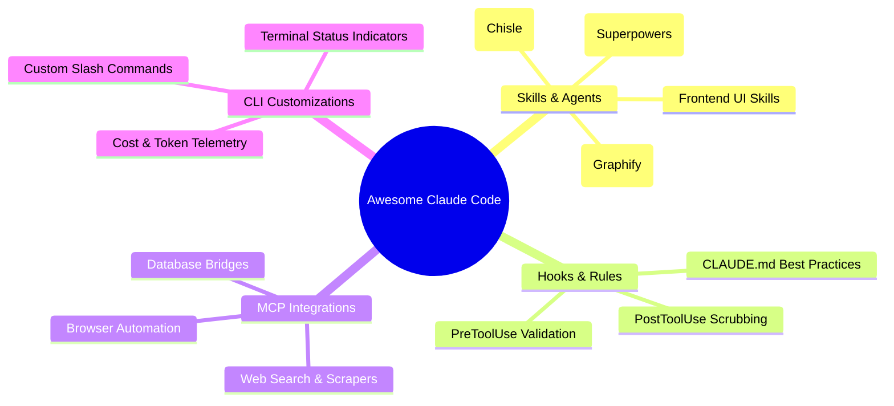

> 🔗 **GitHub Repository**: [hesreallyhim/awesome-claude-code](https://github.com/hesreallyhim/awesome-claude-code)

---

# ⭐ Awesome Claude Code

> **A curated list of awesome Claude Code resources, agent skills, custom tools, hooks, slash commands, status lines, and MCP servers.**

[](https://awesome.re)
[](https://github.com/hesreallyhim/awesome-claude-code)
[](https://opensource.org/licenses/MIT)
[](https://docs.anthropic.com/en/docs/agents-and-tools/claude-code)

---

## 🚀 Overview

**`hesreallyhim/awesome-claude-code`** is the canonical, community-driven catalog celebrating the rapidly expanding Claude Code ecosystem. 

As developers expand beyond default out-of-the-box CLI functionality, this directory organizes the best third-party plugins, specialized skill sets, automated hooks, system prompt tweaks, and Model Context Protocol (MCP) integrations in one curated repository.

---

## 🗂️ Curated Ecosystem Categories

| Category | Description | Examples |
|---|---|---|
| **🛠️ Agent Skills & Tools** | Pre-packaged domain capabilities that expand what Claude Code can execute autonomously. | UI Skills, Graphify, Chisle, Superpowers |
| **🪝 Hooks & Automations** | Scripts triggering pre-tool or post-tool execution (e.g., auto-formatting, token scrubbers, lint gates). | Pre-commit linter hooks, token eliders |
| **⚡ Slash Commands** | Custom prompt workflows invoked directly inside the terminal interface (`/plan`, `/review`, `/fix`). | Systematic spec breakdown, security auditing |
| **🔌 MCP Servers** | Model Context Protocol servers connecting Claude Code to databases, local browsers, and SaaS APIs. | GitHub MCP, Postgres MCP, Filesystem MCP |
| **📊 UI & Status Lines** | Terminal statusline customizers, cost trackers, and token usage monitors. | Custom git statuslines, model usage badges |
| **🎓 Guides & Workflows** | High-discipline tutorials on context management, subagent teams, and TDD with Claude Code. | Best practice blueprints, creator interviews |

---

## 🧩 Architectural Map



---

## 💻 Quick Start: Adding Community Skills

Claude Code supports installing community extensions directly from Git repositories and plugin marketplaces:

```bash
# Add a plugin from the community marketplace
claude plugin marketplace add <author>/<plugin-name>

# Install a specific community skill
claude plugin install <plugin>@<version>

# Example: Run custom slash command
/<command-name> "Target feature or refactor"
```

---

## 🌟 Featured Community Highlights

- **[UI Skills](ui-skills.md)**: Opinionated design engineering guidelines and component polish rules.
- **[Chisle](chisle.md)**: Zero-dependency token compressor reducing context bloat by up to 56%.
- **[Graphify](graphify.md)**: Multimodal knowledge graph generator creating interactive dependency maps.
- **[Claude Code Best Practice](claude-code-best-practice.md)**: Production-grade blueprints from certified architects.
- **[Everything Claude Code](everything-claude-code.md)**: Full agentic toolkit by Anthropic hackathon winners.

---

## 🔗 Official Links

- **GitHub Repository**: [hesreallyhim/awesome-claude-code](https://github.com/hesreallyhim/awesome-claude-code)
- **Author**: [hesreallyhim](https://github.com/hesreallyhim)
- **Official Claude Code Documentation**: [docs.anthropic.com](https://docs.anthropic.com/en/docs/agents-and-tools/claude-code)

---

*← Back to [AI Agents & Skills](./README.md) · [GitHub Repos Hub](../README.md) · [Root Index](../../README.md)*
