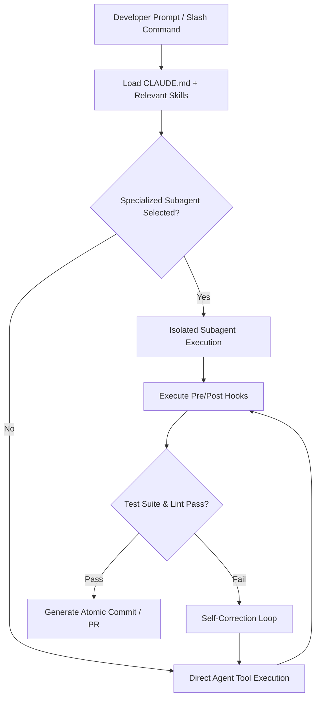

> 🔗 **GitHub Repository**: [shanraisshan/claude-code-best-practice](https://github.com/shanraisshan/claude-code-best-practice)

---

# 🥋 Claude Code Best Practice

> **From vibe coding to agentic engineering.** Battle-tested architecture, patterns, `.claude/` blueprints, and production workflows for Anthropic's Claude Code terminal assistant.

[](https://opensource.org/licenses/MIT)
[](https://github.com/shanraisshan/claude-code-best-practice)
[](https://docs.anthropic.com/en/docs/agents-and-tools/claude-code)
[](#-architectural-blueprints)

---

## 🚀 Overview

Created by Shayan Rais (Claude Community Ambassador & Certified Claude Architect), **claude-code-best-practice** provides a structured engineering foundation for teams migrating from conversational "vibe coding" to disciplined, autonomous agentic engineering.

Frontier AI coding agents degrade when overwhelmed with excessive instructions, unindexed mono-repositories, or unconstrained tool calls. This repository codifies real-world practices gleaned from Claude Code core contributors (including Boris Cherny) and top engineering teams.

### Core Objectives

1. **Context Window Optimization**: Prevent frontier LLM context degradation by keeping steering files lean and focused.
2. **Deterministic Architecture**: Organize workflows into subagents, skills, commands, hooks, and MCP servers.
3. **Reproducible Quality**: Implement strict test-driven development (TDD) and systematic verification loops before committing code.

---

## 🏛️ Architectural Blueprints (`.claude/`)

Claude Code projects achieve maximum efficiency through a standardized directory hierarchy:

```
my-project/
├── CLAUDE.md                     # High-level steering rules (keep under 60-150 lines)
├── .mcp.json                     # Model Context Protocol external tool definitions
└── .claude/
    ├── agents/                   # Isolated subagents with specialized prompts & tools
    │   ├── security-reviewer.md
    │   └── test-architect.md
    ├── commands/                 # User-invoked slash command templates
    │   ├── plan.md
    │   └── refactor.md
    ├── skills/                   # Modular knowledge loaded on-demand (progressive disclosure)
    │   ├── db-migrations/
    │   └── api-design/
    └── hooks/                    # Event-driven scripts outside the direct model loop
        ├── post-tool-exec.sh
        └── pre-commit-check.sh
```

---

## ⚡ Key Best Practices

### 1. The `CLAUDE.md` Discipline Ladder

| Rule | Rationale | Bad Practice |
|---|---|---|
| **Max 150 Lines** | Models selectively miss rules in multi-hundred-line system prompts. | Storing full API specifications or tutorials in `CLAUDE.md`. |
| **Pointers Over Inlining** | Reference specialized skills or documentation files rather than embedding them. | Pasting entire database schema files directly into steering prompts. |
| **Clear Command Verbs** | Give exact test, lint, and build commands (e.g., `npm run test:unit`). | Vague instructions like *"test the code if needed"*. |
| **Negative Constraints** | Clearly specify what NOT to touch (e.g., *"Do not modify locked migration files"*). | Relying solely on positive suggestions without guardrails. |

### 2. Progressive Disclosure via Skills

Instead of saturating Claude Code's initial context with every domain rule:
- Place detailed documentation in `.claude/skills/<skill-name>/SKILL.md`.
- Include clear frontmatter triggers so the model only loads the skill when relevant tasks are triggered.

### 3. Subagents with Scoped Permissions

Break down complex tasks across isolated subagents:
- **Planner Agent**: Evaluates project requirements and creates an atomic task list without executing tool edits.
- **Worker Agent**: Implements one atomic task in a dedicated git branch or worktree.
- **Reviewer Agent**: Validates linting, test suites, and potential security leaks before merge.

---

## 🛠️ Workflow Lifecycle



---

## 💻 Recommended CLI Configurations

### Setting Up a New Repository

```bash
# Clone the best practice template
git clone https://github.com/shanraisshan/claude-code-best-practice.git
cd claude-code-best-practice

# Review recommended CLAUDE.md template
cp templates/CLAUDE.md.template /path/to/your-repo/CLAUDE.md
```

### Essential Slash Commands in Daily Work

```text
/plan "Migrate authentication from sessions to JWT"
/test:coverage
/review:security
```

---

## ⚠️ Anti-Patterns & Pitfalls

| ❌ Anti-Pattern | ✅ Agentic Engineering Pattern |
|---|---|
| Monolithic prompt stuffing with full codebase files | Dynamic symbol navigation via MCP and specialized skills |
| Letting agents edit directly on `main` branch | Utilizing isolated git worktrees or feature branches |
| Accepting unverified AI solutions | Automated test failure reproduction (Red) followed by fix (Green) |
| Conversational chit-chat and apologetic hedging | Concise, outcome-first outputs and structured diffs |

---

## 🔗 Official Links

- **GitHub Repository**: [shanraisshan/claude-code-best-practice](https://github.com/shanraisshan/claude-code-best-practice)
- **Author**: [Shayan Rais](https://github.com/shanraisshan)
- **Official Claude Code Docs**: [docs.anthropic.com/en/docs/agents-and-tools/claude-code](https://docs.anthropic.com/en/docs/agents-and-tools/claude-code)

---

*← Back to [AI Agents & Skills](./README.md) · [GitHub Repos Hub](../README.md) · [Root Index](../../README.md)*
