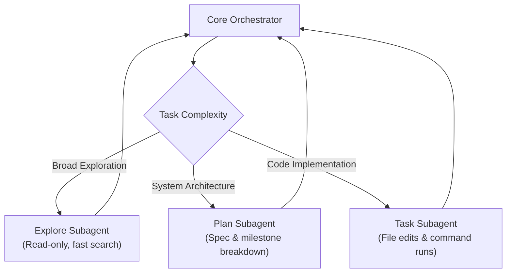

> 🔗 **GitHub Repository**: [Piebald-AI/claude-code-system-prompts](https://github.com/Piebald-AI/claude-code-system-prompts)

---

# 📜 Claude Code System Prompts

> **Deconstructed internal system instructions, tool schemas, and sub-agent architectures powering Anthropic's Claude Code.** Regularly updated archive tracking prompt evolutions, constraints, safety guardrails, and agentic mechanics across versions.

[](https://opensource.org/licenses/MIT)
[](https://github.com/Piebald-AI/claude-code-system-prompts)
[](https://github.com/Piebald-AI/claude-code-system-prompts)
[](#-what-is-inside)

---

## 🚀 Overview

Anthropic's **Claude Code** is widely considered one of the highest-discipline, most capable terminal-based coding agents in production. However, its exact internal system instructions, tool calling contracts, subagent prompts, and context compaction mechanisms are packaged inside the compiled CLI application.

**`Piebald-AI/claude-code-system-prompts`** reverse-engineers, deconstructs, and version-tracks these system prompts across every major Claude Code release. It serves as an invaluable reference for AI engineers, prompt designers, and developers building their own agentic coding frameworks.

---

## 📋 What is Inside

The repository tracks prompt artifacts across four critical categories:

```
claude-code-system-prompts/
├── core/
│   ├── system-prompt.md          # Primary persona, rules of engagement, tone & conciseness
│   └── output-style.md           # Outcome-first formatting constraints
├── subagents/
│   ├── plan-agent.md             # High-level architecture, task breakdown, non-destructive
│   ├── explore-agent.md          # Fast file & grep indexing, code search heuristics
│   └── task-agent.md             # Core atomic implementation worker
├── tools/
│   ├── tool-definitions.json     # Parameter schemas for View, Edit, Bash, Grep, LS
│   └── safety-constraints.md     # Forbidden commands, confirmation gates, sandbox rules
└── mechanics/
    ├── compaction.md             # Context window compression & history summarization
    ├── claude-md-handler.md      # Rules governing how CLAUDE.md is ingested
    └── status-line.md            # Interactive status reporting specifications
```

---

## 🔑 Key Engineering Insights

### 1. The Outcome-First Communication Rule
Claude Code's core system prompt explicitly suppresses conversational filler, chit-chat, and speculative promises. It instructs the model to lead with actions and concrete diffs rather than pleasantries.

### 2. Multi-Tier Subagent Division of Labor



### 3. Progressive Tool Definitions & Guardrails
Tools like `Edit` and `Write` are engineered with strict pre-conditions:
- Forcing exact character-sequence matching for edits to prevent ambiguous replacements.
- Banning invasive shell commands (`rm -rf`, unexpected privilege escalations) without explicit user prompts.
- Structured parameter validation preventing silent syntax corruption.

---

## 💡 How Developers Use This Repository

1. **Benchmarking & Custom Agents**: Study how Anthropic shapes frontier model behavior to build custom agents for internal enterprise stacks.
2. **Optimizing `CLAUDE.md`**: Understand the exact parser and precedence rules Claude Code applies to project steering files to write more effective instructions.
3. **Prompt Customization with `tweakcc`**: Pair with community patch tools (such as Piebald's `tweakcc`) to selectively modify or experiment with internal prompt behavior.

---

## ⚠️ Key Takeaways for Agent Builders

| Lesson | Claude Code Mechanism | Why It Works |
|---|---|---|
| **Eliminate Hedging** | Strict brevity directives | Saves tokens and keeps developer in flow state. |
| **Separation of Concerns** | Read-only Explore vs Edit Task agents | Prevents accidental destructive modifications during search. |
| **Atomic Compaction** | Context compaction prompt | Retains architectural decisions while discarding bloated tool outputs. |
| **Strict File Diffs** | Exact string matching (`old_string` -> `new_string`) | Avoids whole-file rewrites and hallucinations in large files. |

---

## 🔗 Official Links

- **GitHub Repository**: [Piebald-AI/claude-code-system-prompts](https://github.com/Piebald-AI/claude-code-system-prompts)
- **Maintainer**: [Piebald-AI](https://github.com/Piebald-AI)
- **Anthropic Claude Code**: [docs.anthropic.com](https://docs.anthropic.com/en/docs/agents-and-tools/claude-code)

---

*← Back to [AI Agents & Skills](./README.md) · [GitHub Repos Hub](../README.md) · [Root Index](../../README.md)*
