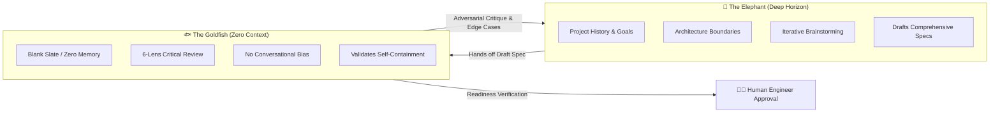

> 🔗 **GitHub Repository**: [google/elephant-goldfish-model](https://github.com/google/elephant-goldfish-model)

---

# 🐘🐟 Elephant-Goldfish Model (EGM)

[](https://opensource.org/licenses/Apache-2.0)
[](https://github.com/google/elephant-goldfish-model)
[](https://egm.dev)

> **Spec-Driven Development (SDD) methodology and agentic skills framework by Google that separates long-horizon architectural vision from stateless, zero-context review.**

The **Elephant-Goldfish Model (EGM)** is an open-source development methodology and multi-agent skill suite created at Google, based on Dave Rensin's foundational work *[Elephants, Goldfish, and the New Golden Age of Software Engineering](https://medium.com/@drensin/elephants-goldfish-and-the-new-golden-age-of-software-engineering-c33641a48874)*. Used by thousands of Google engineers, EGM solves the "velocity of slop" problem in AI-assisted coding by enforcing design-first rigor before code generation.

---

## 📋 Overview

- **What**: An agentic framework and plugin for Antigravity CLI, Claude Code, OpenAI Codex, and ChatGPT Work that decouples deep architectural ideation from adversarial zero-context code review.
- **Why**: AI coding agents suffer from conversational blindness and "agreeableness"—as context windows fill, agents rationalize bad assumptions and miss obvious architectural holes. EGM counteracts this by pitting deep-context agents against blank-slate reviewers.
- **When to Use**:
  - Developing greenfield systems or complex features requiring multi-component trade-offs.
  - Designing public APIs, schema migrations, and event-driven architectures.
  - Stress-testing specifications for hidden assumptions before committing expensive agent compute to implementation.
  - Preventing post-implementation architectural drift across long coding sessions.

---

## 🔑 The Dual Metaphor



| Entity | Role | Context Window | Key Responsibility |
|---|---|---|---|
| **🐘 The Elephant** | Spec Author & Architect | Deep, long-horizon history | Retains project vision, component boundaries, and institutional memory. Brainstorms requirements and drafts exhaustive specifications. |
| **🐟 The Goldfish** | Antagonistic Reviewer | Zero context (stateless subagent) | Evaluates drafts strictly based on what is written and live repository source code. Detects missing context, circular reasoning, and hand-waving. |
| **🧑‍💻 The Engineer** | Arbiter & Decision Maker | Human supervision | Evaluates trade-offs, resolves conflicts between Elephant drafts and Goldfish critiques, and signs off on the specification. |

---

## 🔄 Core Workflow Loop

The EGM loop advances through four structured phases before code implementation starts:

```
  ┌──────────────────┐       ┌──────────────────┐       ┌──────────────────┐       ┌──────────────────┐
  │ 1. Brainstorm    │ ───►  │ 2. Draft         │ ───►  │ 3. Review        │ ───►  │ 4. Drift Check   │
  │ /egm-brainstorm  │       │ /egm-draft       │       │ /egm-review      │       │ /egm-drift-report│
  │ (6-lens swarm)   │       │ (design doc)     │       │ (fresh goldfish) │       │ (post-build audit│
  └──────────────────┘       └──────────────────┘       └──────────────────┘       └──────────────────┘
```

1. **`/egm-brainstorm`**: Explores the initial proposal through guided questioning. Dispatches a 6-lens Goldfish swarm to evaluate feasibility, security, scalability, and UX, saving the agreed consensus into `concepts_brief.md`.
2. **`/egm-draft`**: Converts `concepts_brief.md` into a formal, living design document under `docs/designs/<feature-name>.md` section by section.
3. **`/egm-review`**: Spawns stateless Goldfish subagents to test the design document against reality: Is it self-contained? Are error states specified? Does it violate codebase patterns?
4. **`/egm-drift-report`**: Run post-implementation to inspect git diffs against the approved design doc, flagging unplanned modifications or neglected design requirements.

---

## 🚀 Installation & Runtime Setup

### Antigravity CLI / Gemini CLI

```bash
agy plugin install https://github.com/google/elephant-goldfish-model
```

### Claude Code

```bash
claude plugin marketplace add google/elephant-goldfish-model
claude plugin install egm@egm
```

*(Commands inside Claude Code use the `/egm:` prefix, e.g., `/egm:egm-brainstorm`)*

### OpenAI Codex

```bash
codex plugin marketplace add google/elephant-goldfish-model
codex plugin add egm@egm
```

---

## 🛠️ Commands & Skills Reference

| Command (Antigravity) | Claude Code Alias | Description | Output Artifact |
|---|---|---|---|
| `/egm-brainstorm <idea>` | `/egm:egm-brainstorm` | Interactive requirement elicitation and 6-lens stress testing. | `concepts_brief.md` |
| `/egm-draft` | `/egm:egm-draft` | Builds a formal multi-section technical specification document. | `docs/designs/<feature>.md` |
| `/egm-review` | `/egm:egm-review` | Dispatches zero-context Goldfish subagents to audit design completeness. | Review Critique & Scorecard |
| `/egm-drift-report` | `/egm:egm-drift-report` | Audits implemented code against the specification to detect drift. | `drift_report.md` |

---

## 🔍 The 6-Lens Goldfish Review Matrix

When `/egm-brainstorm` or `/egm-review` executes, the stateless subagents inspect the proposal through six distinct lenses:

```
                  ┌────────────────────────────────────────┐
                  │          6-Lens Goldfish Swarm         │
                  ├───────────────────┬────────────────────┤
                  │ 1. Completeness   │ 4. Operational SRE │
                  │ 2. Security / Auth│ 5. Failure Modes   │
                  │ 3. Scalability    │ 6. Developer UX    │
                  └───────────────────┴────────────────────┘
```

| Lens | Audit Focus | Typical Questions Posed by the Goldfish |
|---|---|---|
| **1. Completeness** | Missing requirements & state | *"What happens on duplicate events? Is idempotency handled?"* |
| **2. Security & Auth** | Threat model & privilege boundaries | *"Where do webhook secrets live? Are replay attacks possible?"* |
| **3. Scalability** | Resource limits & concurrency | *"What happens when 50,000 events fire concurrently?"* |
| **4. Operational SRE** | Observability & metrics | *"How will on-call engineers know when delivery fails?"* |
| **5. Failure Modes** | Retries, timeouts, and degradation | *"What is the retry backoff curve? When is an event marked dead?"* |
| **6. Developer UX** | API ergonomics & readability | *"Is the payload JSON schema intuitive for third-party consumers?"* |

---

## ⚠️ Anti-Patterns vs. EGM Best Practices

| ❌ Common AI Coding Trap | ✅ EGM Discipline |
|---|---|
| **Vibe-Coding Greenfield Features**: Immediately prompting an agent to generate full code from a one-sentence instruction. | **Design-First Invariant**: Run `/egm-brainstorm` and `/egm-draft` to freeze a clear specification before opening source files. |
| **Conversational Echo Chambers**: Asking the same agent that wrote a flawed design to "check its own work." | **Stateless Goldfish**: Zero-context subagents have no memory of how the design was conceived, ensuring objective reviews. |
| **Context Window Degradation**: Cramming design discussion, brainstorming, and hundreds of files into one giant session. | **Clean Subagent Handoff**: The Elephant drafts specs, while short-lived Goldfish subagents execute discrete review tasks. |
| **Architectural Drift**: Agents changing data structures or interfaces during implementation without documenting why. | **Drift Audit**: Use `/egm-drift-report` to verify the git diff matches the approved specification. |

---

## 🌍 Real-World Example: Adding Webhook Delivery

```text
# Step 1: Brainstorm with the Elephant and Goldfish
/egm-brainstorm Add reliable webhook event delivery with retries to our payment service.

# Output: concepts_brief.md outlining exponential backoff, HMAC-SHA256 signatures, and Dead Letter Queue.

# Step 2: Draft the formal design specification
/egm-draft docs/designs/webhook-delivery.md

# Step 3: Run zero-context review
/egm-review docs/designs/webhook-delivery.md

# Goldfish findings:
# - Missing: Payload size limits (DDoS vector if payload > 5MB)
# - Missing: Webhook endpoint timeout duration (recommend 5s)
# - Elephant updates the design document based on feedback.

# Step 4: Engineer signs off and implements feature with standard workflow.

# Step 5: Verify implementation fidelity
/egm-drift-report docs/designs/webhook-delivery.md
```

---

## 📚 References & Resources

- **GitHub Repository**: [google/elephant-goldfish-model](https://github.com/google/elephant-goldfish-model)
- **Official Website**: [egm.dev](https://egm.dev)
- **Original Essay**: [Elephants, Goldfish, and the New Golden Age of Software Engineering](https://medium.com/@drensin/elephants-goldfish-and-the-new-golden-age-of-software-engineering-c33641a48874) by Dave Rensin

---

*← Back to [AI Agents & Skills](./README.md) · [GitHub Repos Hub](../README.md) · [Root Index](../../README.md)*
