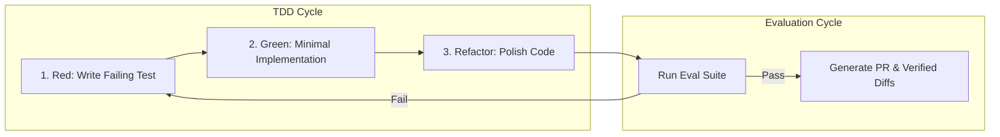

> 🔗 **GitHub Repository**: [WorldFlowAI/everything-claude-code](https://github.com/WorldFlowAI/everything-claude-code)

---

# ⚡ Everything Claude Code

> **Complete production toolkit for Claude Code by Anthropic hackathon winners.** Modular agents, specialized engineering skills (TDD, evaluation-driven development), hooks, rulesets, and Model Context Protocol (MCP) integrations built for heavy, daily product shipping.

[](https://opensource.org/licenses/MIT)
[](https://github.com/WorldFlowAI/everything-claude-code)
[](https://github.com/WorldFlowAI/everything-claude-code)
[](#-modular-toolkit-components)

---

## 🚀 Overview

Built by Anthropic hackathon winners and veteran full-stack engineers at WorldFlow AI, **everything-claude-code** distills hundreds of hours of production software delivery into an organized, drop-in engineering suite for Claude Code.

Rather than relying on basic ad-hoc prompts, this repository delivers ready-to-use configs that turn Claude Code into a disciplined engineering partner capable of autonomous test-driven refactoring, rigorous evaluation loops, and safe multi-agent execution.

---

## 📦 Modular Toolkit Components

```
everything-claude-code/
├── agents/                     # Specialized agent configurations
│   ├── tdd-architect.md        # Enforces Red -> Green -> Refactor methodology
│   ├── eval-runner.md          # Runs automated benchmark & regression suites
│   └── code-reviewer.md        # Static analysis and security audit guardrail
├── skills/                     # High-yield skill libraries (progressive disclosure)
│   ├── test-driven-dev/
│   ├── eval-driven-dev/
│   └── migration-helper/
├── commands/                   # Custom slash-command workflows
│   ├── tdd.md                  # /tdd "feature description"
│   └── eval.md                 # /eval "eval suite"
├── hooks/                      # Automated terminal lifecycle triggers
│   ├── pre-bash-safety.sh      # Blocks destructive commands
│   └── post-edit-format.sh     # Auto-formats modified files with project prettier/biome
└── rules/
    └── CLAUDE.md               # Production-tested template with sensible defaults
```

---

## 🔑 Core Features & Methodology

| Feature | Description |
|---|---|
| **Test-Driven Development (TDD)** | Automatically writes reproducing unit/integration tests before writing any production implementation code. |
| **Evaluation-Driven Development** | Packages automated evaluations into agent loops, assessing whether refactors maintain strict behavioral parity. |
| **Safety Shell Hooks** | Intercepts destructive bash commands (`rm -rf`, unexpected git resets) before execution. |
| **Context Hygiene Rules** | Prevents context window saturation with strict token limits and progressive skill loading. |
| **Battle-Tested `CLAUDE.md`** | Production-ready system prompt baseline optimized for modern web and backend stacks. |

---

## 🔄 TDD & Evaluation-Driven Lifecycle



---

## 🚀 Quick Setup & Usage

### 1. Clone into your project

```bash
git clone https://github.com/WorldFlowAI/everything-claude-code.git /tmp/ecc
cp -r /tmp/ecc/.claude ./
cp /tmp/ecc/rules/CLAUDE.md ./CLAUDE.md
```

### 2. Using Custom Slash Commands

```text
# Run a strict TDD iteration:
/tdd "Implement rate limiting middleware for express router"

# Run evaluation suite:
/eval "Test checkout flow resilience under simulated network timeouts"
```

---

## ⚠️ Anti-Patterns Prevented

| ❌ Common AI Mistake | ✅ Everything Claude Code Solution |
|---|---|
| Writing production code without verification tests | Mandates writing failing tests first via `/tdd` |
| Overwriting working code with silent regressions | Runs automated evaluation matrices via `/eval` |
| Accidental destructive file deletion | Hook scripts intercept dangerous shell commands |
| Bloated prompt contexts | Modular skills loaded strictly on-demand |

---

## 🔗 Official Links

- **GitHub Repository**: [WorldFlowAI/everything-claude-code](https://github.com/WorldFlowAI/everything-claude-code)
- **Organization**: [WorldFlow AI](https://github.com/WorldFlowAI)
- **Anthropic Claude Code**: [docs.anthropic.com](https://docs.anthropic.com/en/docs/agents-and-tools/claude-code)

---

*← Back to [AI Agents & Skills](./README.md) · [GitHub Repos Hub](../README.md) · [Root Index](../../README.md)*
