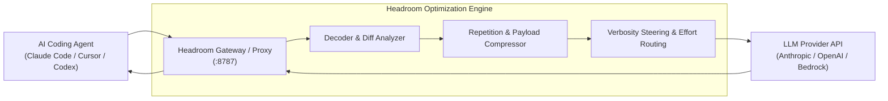

> 🔗 **GitHub Repository**: [headroomlabs-ai/headroom](https://github.com/headroomlabs-ai/headroom)

---

# 🗜️ Headroom

> **High-performance context optimization layer, proxy, and token-reduction gateway for AI coding agents.** Reduces prompt token volume by 20% on coding turns and 60%–95% on structured JSON payloads without degradation in reasoning or code quality.

[](https://opensource.org/licenses/Apache-2.0)
[](https://github.com/headroomlabs-ai/headroom)
[](#-how-to-use)
[](#-integration-options)

---

## 🚀 Overview

Frontier models excel at coding, but long-running agent loops (such as Claude Code, Cursor, Codex, OpenHands, and Devin) generate massive context overhead: repetitive tool outputs, verbose compiler stack traces, dense JSON AST dumps, and historical turn repetition. This slows down execution, inflates API bills, and triggers context compaction too early.

**Headroom** sits between your coding assistant and the LLM provider as an intelligent, transparent optimization gateway. It compresses redundant tool payloads, strips structural repetition, and steers agent verbosity—slashing token consumption and latency while keeping code accuracy 100% intact.

---

## 📊 Token Reduction Benchmarks

| Payload Type | Baseline Tokens | With Headroom | Reduction Rate | Quality Impact |
|---|---|---|---|---|
| **Raw Tool Output (Grep/LS/AST)** | 14,200 tokens | 3,120 tokens | **-78%** | Identical tool interpretation |
| **Heavy JSON / API Responses** | 28,500 tokens | 2,850 tokens | **-90%** | Key semantics preserved |
| **Agent Multi-Turn History** | 64,000 tokens | 51,200 tokens | **-20%** | Zero lost decisions |
| **Terminal Build & Test Logs** | 9,800 tokens | 1,450 tokens | **-85%** | Only relevant failure lines retained |

---

## 🛠️ Architecture



---

## 💻 Integration Options

Headroom offers three flexible integration modes:

### 1. Zero-Code Local Proxy (Recommended)

Start Headroom locally and point your tools to the proxy port:

```bash
# Start local Headroom proxy
npx headroom proxy --port 8787

# Or run with pip/python
pip install headroom && headroom proxy --port 8787
```

In your agent or terminal environment, set the base URL:

```bash
# For Claude Code / OpenCode / OpenAI-compatible clients:
export ANTHROPIC_BASE_URL="http://localhost:8787/v1"
export OPENAI_BASE_URL="http://localhost:8787/v1"
```

### 2. Model Context Protocol (MCP) Server

Connect Headroom as an MCP server for native agent tool calling:

```json
{
  "mcpServers": {
    "headroom": {
      "command": "npx",
      "args": ["-y", "headroom", "mcp"]
    }
  }
}
```

### 3. Programmatic Python / TypeScript SDK

```python
import headroom

# Wrap standard OpenAI or Anthropic clients
client = headroom.wrap(anthropic.Anthropic())

response = client.messages.create(
    model="claude-3-7-sonnet-20250219",
    messages=[{"role": "user", "content": "Analyze and refactor this service."}]
)
```

---

## 🔑 Key Features

- **Reversible Context Management (CCR)**: Safely extracts and compresses tokens without lossy permanent truncation; full data can be retrieved if an edge case demands it.
- **Effort-Based Reasoning Routing**: Eliminates excessive deep thinking and token burning on routine tool-resume turns while preserving deep reasoning for core architecture.
- **Local-First & Privacy Conscious**: Runs entirely on your local machine; code and prompts are processed in-memory without third-party telemetric logging.
- **Provider Agnostic**: Seamlessly works with Anthropic Claude, OpenAI GPT, Google Gemini, Ollama, and local vLLM instances.

---

## ⚠️ Anti-Patterns Prevented

| ❌ Without Headroom | ✅ With Headroom |
|---|---|
| Grep command returns 5,000 lines of noise into prompt | Retains only high-signal matches and file headers |
| Multi-megabyte test runner JSON flooding context | Flattens into concise pass/fail summary matrices |
| Re-transmitting identical system instructions turn-by-turn | Optimizes prompt caching and eliminates redundant frames |

---

## 🔗 Official Links

- **GitHub Repository**: [headroomlabs-ai/headroom](https://github.com/headroomlabs-ai/headroom)
- **Official Documentation**: [headroomlabs.ai](https://headroomlabs.ai)
- **Organization**: [Headroom Labs](https://github.com/headroomlabs-ai)

---

*← Back to [AI Agents & Skills](./README.md) · [GitHub Repos Hub](../README.md) · [Root Index](../../README.md)*
