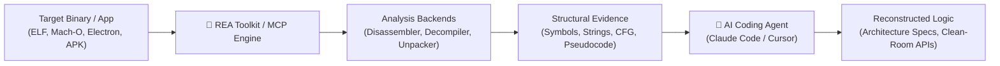

> 🔗 **GitHub Repository**: [morluto/rea](https://github.com/morluto/rea)

---

# 🔍 REA (Reverse Engineer Anything)

> **Agentic reverse-engineering toolkit and MCP server for AI coding assistants.** Created by Renato Losio (`morluto`), REA equips AI coding agents (Claude Code, Cursor, Codex) to analyze closed-source software, inspect native binaries, decompile Electron apps, trace network protocols, and reconstruct application logic using evidence-based inspection.

[](https://opensource.org/licenses/MIT)
[](https://github.com/morluto/rea)
[](#-model-context-protocol-mcp-setup)
[](https://github.com/morluto/rea)

---

## 🚀 Overview

Analyzing compiled applications, closed-source libraries, or obfuscated JavaScript bundles traditionally requires manually toggling between disassemblers (like Ghidra, IDA Pro, Hopper, or radare2), network sniffers, and an LLM window. When asked to reverse engineer behavior from scratch, LLMs frequently hallucinate function signatures, control flows, and internal protocols.

**REA (Reverse Engineer Anything)** bridges this gap by turning AI agents into active reverse-engineering investigators. Via the Model Context Protocol (MCP) and dedicated CLI tools, REA lets agents inspect binary symbols, extract strings, deobfuscate Electron ASAR archives, analyze API endpoints, and inspect assembly/pseudocode directly within the agent conversation loop.

---

## ⚡ Core Capabilities

- **Evidence-Based Deconstruction**: Feeds verifiable decompilation artifacts, symbols, and disassembly directly to the agent context instead of letting the model guess.
- **Native Binary Inspection**: Interfaces with disassemblers and binary analysis toolchains (strings, objdump, Ghidra, radare2) to examine ELF, Mach-O, and PE/COFF files.
- **Electron & Web Application Unpacking**: Automatically unpacks `.asar` archives, recovers source maps, and formats minified bundles to trace client-side logic.
- **Protocol & Network Replay**: Analyzes local API traffic, undocumented WebSocket frames, and RPC schemas.
- **MCP Server Native**: Seamlessly integrates as an MCP tool provider for Claude Code, Cursor, Windsurf, and custom agent harnesses.

---

## 📐 Inspection Workflow



---

## 📦 Installation & Setup

### CLI Installation

```bash
# Clone the repository
git clone https://github.com/morluto/rea.git
cd rea

# Install dependencies and build CLI
npm install
npm run build
npm link
```

### Model Context Protocol (MCP) Setup

Connect REA directly to your AI agent environment by adding it to your MCP configuration:

#### Claude Code (`~/.claude.json` or `.mcp.json`)

```json
{
  "mcpServers": {
    "rea": {
      "command": "npx",
      "args": ["-y", "rea-mcp"]
    }
  }
}
```

#### Cursor (`.cursor/mcp.json`)

```json
{
  "mcpServers": {
    "rea": {
      "command": "rea",
      "args": ["mcp"]
    }
  }
}
```

---

## 🛠️ Example Agent Prompts

```text
# Analyze an Electron desktop application
"Use REA to unpack app.asar in /Applications/ExampleApp.app and explain how the license validation routine operates."

# Inspect binary symbols and functions
"Run REA binary analysis on ./target-daemon. Extract exported symbols, check for hardcoded endpoints, and identify the main socket listener loop."

# Protocol reconstruction for interoperability
"Analyze the captured network frames using REA and generate a TypeScript client SDK matching the internal API."
```

---

## ⚠️ Responsible Usage

> [!CAUTION]  
> REA is intended for interoperability research, security audits, vulnerability research, and understanding undocumented protocols. Always ensure you have authorization to inspect target software and respect software licenses and copyright laws.

---

## 🔗 Official Links

- **GitHub Repository**: [morluto/rea](https://github.com/morluto/rea)

---

*← Back to [AI Agents & Skills](./README.md) · [GitHub Repos Hub](../README.md) · [Root Index](../../README.md)*
