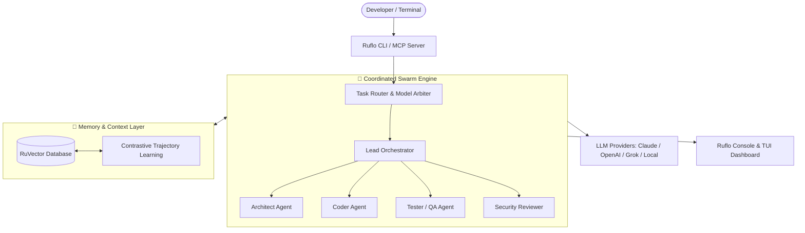

> 🔗 **GitHub Repository**: [ruvnet/ruflo](https://github.com/ruvnet/ruflo)

---

# 🌊 Ruflo

[](https://www.npmjs.com/package/ruflo)
[](https://github.com/ruvnet/ruflo)
[](https://opensource.org/licenses/MIT)
[](https://github.com/ruvnet/ruflo)

> **Enterprise multi-agent meta-harness, swarm orchestration framework, adaptive vector memory, and terminal cockpit for Claude Code, Codex, and MCP clients.**

Ruflo (originally founded as *Claude Flow* by [Reuven Cohen / `@rUv`](https://github.com/ruvnet)) is an execution harness that surrounds AI coding models with a complete nervous system: coordinating swarms of 100+ specialized agents, persistent local memory via RuVector, intelligent model routing, cross-machine federation, and interactive cockpits.

---

## 📋 Overview

- **What**: An agent meta-harness and orchestration runtime designed to manage, coordinate, and supervise autonomous multi-agent workflows across Claude Code, OpenAI Codex, Grok, and MCP-compatible environments.
- **Why**: An LLM is simply a model; on its own, it lacks long-term context retention, multi-agent delegation protocols, sandbox controls, and feedback learning loops. Ruflo formalizes the equation: **`Agent = Model + Harness`**.
- **When to Use**:
  - Running multi-agent swarms with specialized roles (planner, architect, coder, tester, security reviewer).
  - Preserving learned patterns and contextual memory across coding sessions without re-explaining architecture.
  - Monitoring token consumption, cost metrics, agent state transitions, and execution replays via a dedicated terminal console (TUI) or web cockpit.
  - Enforcing strict security guardrails and granular permission boundaries (`read`, `write`, `manage`, `full`) on autonomous agent actions.

---

## 🔑 Key Features & Architecture



| Component | Description |
|---|---|
| **Swarm Orchestration** | Coordinates 100+ specialized personas (coders, testers, architects, security reviewers) with task delegation, consensus protocols, and parallel execution waves. |
| **RuVector Memory** | Local vector store providing persistent long-term memory, graph relationships, and contrastive trajectory learning without requiring cloud embeddings for local retrieval. |
| **Model Routing** | Dispatches routine tasks to lightweight local models or high-throughput endpoints while reserving frontier reasoning models for high-complexity architecture decisions. |
| **Console & TUI Cockpit** | Rich interactive terminal interface (`npx ruflo tui`) and web console with the Orbital theme, live swarm graphs, cost telemetry, and mission logs. |
| **Claude Control & Guardrails** | Granular permission levels (`read`, `write`, `manage`, `full`) paired with approval gates (`ask` or `auto`), allowing humans to pause or revoke execution instantly. |
| **Federated Agents** | Cross-machine networking enabling distributed agents on separate hardware to communicate securely via authenticated tunnels. |

---

## 🚀 Quick Start & Installation

### Option 1: Claude Code Native Plugin (Recommended for Claude Code)

Install Ruflo directly inside Claude Code (requires version 2.1.287+):

```text
/plugin marketplace add ruvnet/ruflo
/plugin install ruflo-core@ruflo
/plugin install ruflo-console@ruflo
/plugin install ruflo-mods@ruflo
/reload-plugins
/ruflo
```

- **`ruflo-core`**: Base agent toolset, mission dispatch, and MCP hooks.
- **`ruflo-console`**: Terminal UI and mission control cockpit.
- **`ruflo-mods`**: Runtime hooks for policy enforcement and routing.

---

### Option 2: Full CLI & MCP Setup (Codex, Antigravity, OpenCode, Cursor)

Initialize Ruflo with the guided setup wizard:

```bash
npx ruflo@latest init wizard
```

To initialize specifically for Grok or other environments:

```bash
npx ruflo@latest init --grok
```

---

### Option 3: Connect via Model Context Protocol (MCP)

Configure your agent runtime's MCP configuration (`mcp_config.json` or `.gemini/config/` / Claude desktop config):

```json
{
  "mcpServers": {
    "ruflo": {
      "command": "npx",
      "args": ["-y", "ruflo@latest", "mcp", "start"]
    }
  }
}
```

Or run the MCP server directly in the terminal:

```bash
npx -y ruflo@latest mcp start
```

---

### Option 4: Standalone Terminal UI (TUI)

Launch the visual dashboard without Claude Code:

```bash
# Interactive visual cockpit
npx ruflo tui

# Single plain frame for CI / script pipelines
npx ruflo tui --plain
```

---

## 🛠️ Usage & Commands Reference

### CLI Commands

| Command | Description |
|---|---|
| `npx ruflo init wizard` | Launch interactive project setup wizard. |
| `npx ruflo init --grok` | Initialize Grok-specific agent surface and operator guide. |
| `npx ruflo tui` | Open the interactive terminal console with Swarm and Cost views. |
| `npx ruflo mcp start` | Start the local stdio MCP server for agent integration. |
| `npx ruvector` | Inspect or manage the local vector memory store. |

### Claude Code Slash Commands

| Command | Description |
|---|---|
| `/ruflo` | Open the agent cockpit and mission manager. |
| `/plugin marketplace add ruvnet/ruflo` | Add Ruflo official plugin repository. |
| `/plugin install ruflo-core@ruflo` | Install foundational harness tools. |
| `/plugin install ruflo-console@ruflo` | Install interactive cockpit and dashboard. |
| `/reload-plugins` | Reload runtime plugin registry. |

---

## 🔒 Security & Claude Control Levels

Ruflo incorporates configurable boundary controls to protect repositories from unauthorized modifications or runaway costs:

| Permission Level | Permitted Actions | Approval Modes |
|---|---|---|
| `read` *(Default)* | Read files, inspect memory graph, retrieve context, view logs | `ask` (Prompt on every action) |
| `write` | Create files, run tests, propose diffs, log missions | `ask` (Recommended) or `auto` |
| `manage` | Trigger agent swarms, branch tasks, invoke background daemons | Requires explicit confirmation |
| `full` | Network calls, cloud deploys, spending allocation, git push | Protected by irreversible approval checks |

> [!TIP]
> Use **Take back control** in the console at any point to instantly revoke tool execution permissions from running agents.

---

## ⚠️ Anti-Patterns vs. Best Practices

| ❌ Anti-Pattern | ✅ Better Approach |
|---|---|
| Relying on a single monolithic model to handle planning, coding, and review in one context window. | Deploy a coordinated **agent swarm** using Ruflo where specialized subagents handle architecture, TDD, and security review in parallel. |
| Losing codebase context and bug discovery history between terminal restarts. | Enable **RuVector persistent memory** to index architectural decisions and past test solutions across sessions. |
| Granting unconstrained file and network write privileges to automated agent loops. | Use Ruflo's **Claude Control boundaries** set to `write + ask` to supervise high-impact operations. |
| Routing all simple queries to costly top-tier frontier models. | Use Ruflo's **adaptive routing** to dispatch mechanical edits to fast models and reserve frontier models for complex reasoning. |

---

## 🌍 Real-World Use Case: Autonomous Swarm Feature Development

**Scenario**: A engineering team needs to implement an OAuth2 authentication flow with rate limiting and automated integration tests on an existing Express/TypeScript codebase.

1. **Mission Initialization**: The developer initiates the task inside Claude Code:
   ```text
   /ruflo
   "Create a mission to implement OAuth2 Google login with Redis rate limiting and end-to-end tests."
   ```
2. **Swarm Decomposition**:
   - The **Architect Agent** designs the token rotation and middleware contract.
   - The **RuVector Memory** checks past codebase conventions and existing Redis connection patterns.
   - The **Coder Agent** implements routes and controllers.
   - The **Tester Agent** writes failing integration tests, verifies them, and refactors.
   - The **Security Reviewer Agent** audits token storage against OWASP vulnerabilities.
3. **Telemetry & Verification**: The developer reviews real-time token spend, test logs, and diffs in `npx ruflo tui`, approves the final PR, and stores successful execution trajectories back into RuVector.

---

## 📚 References & Ecosystem

- **GitHub Repository**: [ruvnet/ruflo](https://github.com/ruvnet/ruflo)
- **Author**: [Reuven Cohen (@rUv)](https://github.com/ruvnet)
- **RuVector Local Memory**: [ruvnet/ruvector](https://github.com/ruvnet/ruvector)
- **ruOS Desktop**: [ruos.cognitum.one](https://ruos.cognitum.one)
- **RuFlo Explained Guide**: [14-Chapter Deep Dive](https://github.com/ruvnet/ruflo/blob/main/docs/ruflo-explained.md)

---

*← Back to [AI Agents & Skills](./README.md) · [GitHub Repos Hub](../README.md) · [Root Index](../../README.md)*
