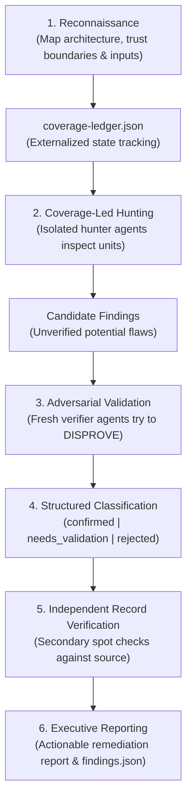

> 🔗 **GitHub Repository**: [cloudflare/security-audit-skill](https://github.com/cloudflare/security-audit-skill)

---

# 🛡️ Cloudflare Security Audit Skill

> **Adversarial, multi-agent security auditing skill for AI coding assistants.** Built by Cloudflare to turn AI coding agents (such as Claude Code) into rigorous security auditors using a structured 6-phase review process, externalized coverage ledgers, and dedicated verifier agents that actively attempt to disprove findings to eliminate false positives.

[](https://opensource.org/licenses/Apache-2.0)
[](https://github.com/cloudflare/security-audit-skill)
[](https://cloudflare.com)
[](https://github.com/cloudflare/security-audit-skill)

---

## 🚀 Overview

Standard LLM code security reviews suffer from two critical flaws:
1. **Shallow Context & Amnesia**: The model inspects top-level files, misses deeply nested calls, and hallucinates vulnerabilities that are actually sanitized elsewhere.
2. **High False-Positive Noise**: LLMs flag standard idioms or benign patterns as critical vulnerabilities because they do not verify exploitability.

**Cloudflare Security Audit Skill** treats the LLM as stateless compute driven by externalized file-based state. It enforces an adversarial, multi-agent review pipeline: hunter agents discover candidates, but each finding must survive scrutiny from a freshly instantiated **verifier agent** whose explicit objective is to disprove the vulnerability.

---

## ⚡ The 6-Phase Audit Architecture



### Phase Breakdown

| Phase | Purpose | Output Artifact |
|---|---|---|
| **1. Reconnaissance** | Maps architectural components, attack surfaces, data flows, and trust boundaries. | `coverage-ledger.json` |
| **2. Coverage-Led Hunting** | Deploys isolated hunter sub-agents across code units with dedicated focus. | Raw candidate issues |
| **3. Adversarial Validation** | Launches fresh, unbiased verifier agents charged with disproving each finding. | Validation verdicts |
| **4. Structured Ledger** | Formats findings against strict JSON schemas with severity, line references, and PoC paths. | `findings.json` |
| **5. Record Verification** | Secondary check to guarantee findings match exact commit SHAs and live code. | Verified ledger |
| **6. Final Report** | Emits a human-readable security assessment with prioritized remediation advice. | `SECURITY_AUDIT.md` |

---

## 📦 Installation & Setup

### Via the Skills CLI

```bash
# Install directly from the Cloudflare repository
npx skills add https://github.com/cloudflare/security-audit-skill --skill security-audit
```

### Manual Configuration for Claude Code

```bash
# Clone the skill into your local Claude skills directory
mkdir -p ~/.claude/skills/security-audit
git clone https://github.com/cloudflare/security-audit-skill.git ~/.claude/skills/security-audit
```

---

## 🛠️ Typical Agent Usage Prompts

```text
# Run full comprehensive codebase audit
"/security-audit Perform a comprehensive security review of this repository focusing on authentication, input validation, and SSRF."

# Focused target audit on API endpoints
"/security-audit Audit all controllers and middlewares in src/api/ for privilege escalation and IDOR flaws."

# Audit third-party integration boundaries
"/security-audit Map trust boundaries and audit external webhook signature verifications."
```

---

## ⚠️ Operational Safety & Sandboxing

> [!IMPORTANT]  
> Because security audit skills instruct AI agents to explore attack vectors and probe execution paths, Cloudflare strongly advises running audit sessions inside a **sandboxed container or ephemeral virtual machine** with restricted network access to prevent accidental side effects.

---

## 🔗 Official Links

- **GitHub Repository**: [cloudflare/security-audit-skill](https://github.com/cloudflare/security-audit-skill)
- **Cloudflare Engineering Blog**: [blog.cloudflare.com](https://blog.cloudflare.com)

---

*← Back to [AI Agents & Skills](./README.md) · [GitHub Repos Hub](../README.md) · [Root Index](../../README.md)*
