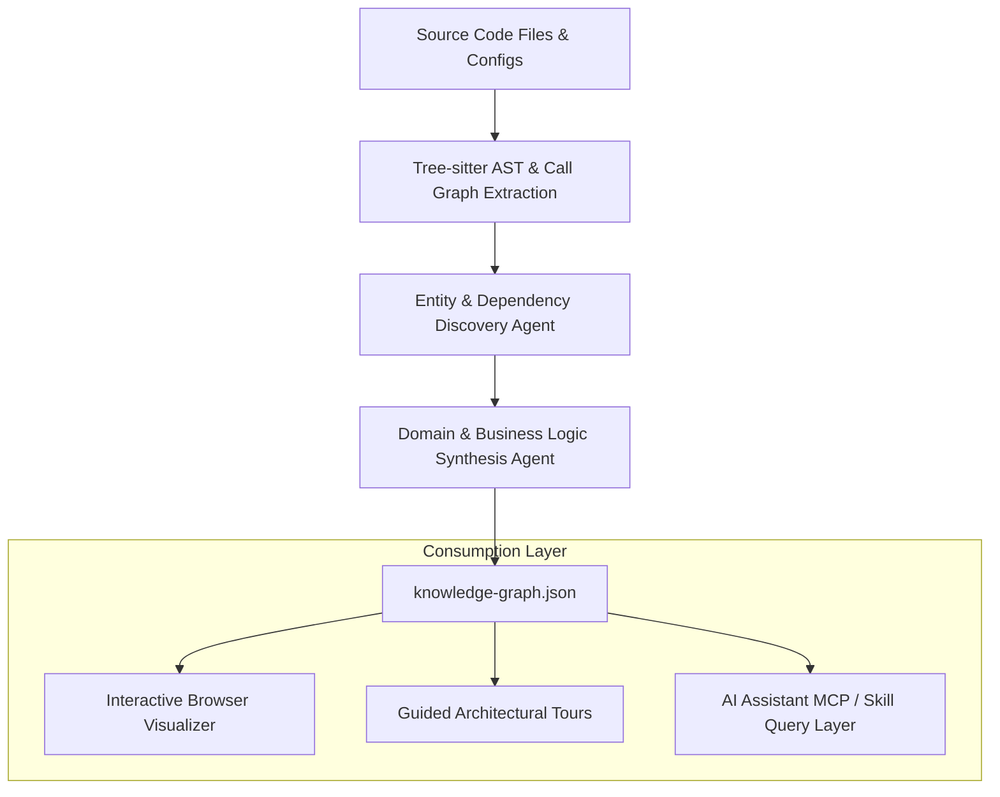

> 🔗 **GitHub Repository**: [Egonex-AI/Understand-Anything](https://github.com/Egonex-AI/Understand-Anything)

---

# 🧭 Understand-Anything

> **Codebase knowledge graph & mental model engine for AI coding assistants.** Transforms complex codebases into searchable, interactive visual knowledge graphs bridging raw AST syntax trees with real-world business logic and domain flows.

[](https://opensource.org/licenses/MIT)
[](https://github.com/Egonex-AI/Understand-Anything)
[](#-supported-ecosystem)
[](https://understand-anything.com)

---

## 🚀 Overview

Modern codebases are often vast and interconnected. Traditional AI coding agents rely on simple regex grep or full-text embeddings, which frequently yield either irrelevant snippets or massive "context hairballs" of raw syntax without domain understanding.

**Understand-Anything** is an open-source tool and multi-agent pipeline that analyzes a codebase and generates a structured, multi-layer **Knowledge Graph** (`knowledge-graph.json`). It bridges low-level code mechanics (functions, classes, AST nodes) with high-level business domains (e.g., checkout flows, auth lifecycles, billing webhooks).

---

## 🔑 Key Capabilities

| Capability | Description |
|---|---|
| **Multi-Agent Pipeline** | Employs AST parsers (Tree-sitter) combined with specialized LLM agents to map functional dependencies and semantic concepts. |
| **Business Flow Mapping** | Automatically identifies business processes across services (e.g., user registration -> email verification -> DB transaction). |
| **Interactive Graph UI** | Renders visual, zoomable dependency and architecture diagrams directly in the browser or terminal. |
| **Structured Guided Tours** | Produces step-by-step code walkthroughs for developer onboarding and architectural reviews. |
| **Agent Skill Integration** | Directly callable by Claude Code, Cursor, Codex CLI, and Gemini CLI to fetch targeted subgraphs instead of bloating context. |

---

## 🏗️ Knowledge Graph Architecture



---

## 📦 Installation & Setup

### CLI Installation

Install globally or run on-demand via `npx` / `pip`:

```bash
# Run directly against any project directory
npx @egonex/understand-anything analyze .

# Or install globally
npm install -g @egonex/understand-anything
```

### Claude Code Skill Setup

Add Understand-Anything as an agent skill:

```bash
claude plugin marketplace add Egonex-AI/Understand-Anything
claude plugin install understand-anything@egonex
```

### Generated Artifacts

Running the analyzer creates an `understand/` directory:

```
understand/
├── knowledge-graph.json   # Machine-readable node, edge, and domain schema
├── index.html             # Standalone interactive visual graph explorer
├── tours/                 # Step-by-step domain walkthrough markdown files
│   ├── auth-flow.md
│   └── data-pipeline.md
└── architecture-summary.md
```

---

## 🤖 Supported Ecosystem

Understand-Anything natively feeds structured context into leading agent runtimes:

- **Claude Code**: Via slash command `/understand` and MCP server.
- **Cursor**: Via `.cursorrules` pointing to `understand/knowledge-graph.json`.
- **GitHub Copilot CLI**: Querying semantic dependencies before code generation.
- **Gemini CLI / Antigravity**: Integrated as a workspace code understanding skill.
- **OpenCode & Codex CLI**: Consumed via headless JSON query APIs.

---

## 💡 Typical Agent Workflow

```text
# Prompting an AI Agent with Understand-Anything:
"Use the understand-anything skill to map how user billing webhooks 
propagate through the event bus to the subscription database."
```

Instead of reading 50 files into context, the agent inspects the synthesized domain tour and loads only the 3 strictly relevant handler files.

---

## 🔗 Official Links

- **GitHub Repository**: [Egonex-AI/Understand-Anything](https://github.com/Egonex-AI/Understand-Anything)
- **Official Website**: [understand-anything.com](https://understand-anything.com)
- **Interactive Demos**: [ui-skills.com](https://ui-skills.com)

---

*← Back to [AI Agents & Skills](./README.md) · [GitHub Repos Hub](../README.md) · [Root Index](../../README.md)*
