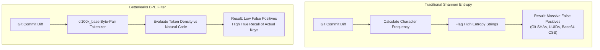

> 🔗 **GitHub Repository**: [betterleaks/betterleaks](https://github.com/betterleaks/betterleaks)

---

# ⚡ Betterleaks

> **Next-generation static application security testing (SAST) tool and secret scanner.** Built by Zachary Rice (creator of Gitleaks) as a drop-in replacement that uses Byte-Pair Encoding (BPE) tokenization, active credential validation, and recursive decoding to eliminate false positives.

[](https://opensource.org/licenses/MIT)
[](https://github.com/betterleaks/betterleaks)
[](https://go.dev)
[](#-gitleaks-compatibility)

---

## 🚀 Overview

While classical secret scanners rely on Shannon entropy to find high-randomness strings, entropy metrics produce notorious false-positive rates on random UUIDs, SHA256 hashes, CSS class names, and base64 assets. Furthermore, traditional scanners can only report matched strings without verifying if they represent live, active credentials.

**Betterleaks** is designed by the creator of Gitleaks as an architectural evolution. Written in pure Go without CGO or Hyperscan dependencies, it incorporates **Byte-Pair Encoding (BPE)** tokenization (`cl100k_base`), asynchronous active secret validation, and automated multi-layer archive/encoding unwrapping.

---

## ⚡ Gitleaks vs. Betterleaks Comparison

| Feature | Gitleaks | Betterleaks |
|---|---|---|
| **Randomness Filter** | Shannon Entropy (high noise on hashes/UUIDs) | **Byte-Pair Encoding (BPE) Tokenization** (GPT-grade token compression) |
| **Credential Validation** | Static detection only | **Live Validation Engine** (verifies if token is active via API probes) |
| **Decoding Support** | Direct text matching | **Recursive Unwrapping** (Base64, Hex, URL, Unicode, Tar, Zip) |
| **Dependencies** | Requires CGO / Hyperscan on some platforms | **100% Pure Go** (zero CGO, effortless cross-compilation) |
| **Configuration** | `.gitleaks.toml` | **Drop-in support** for existing `.gitleaks.toml` files |
| **Scan Throughput** | Fast | **Multi-core streaming pipeline** (up to 3x faster on multi-GB repos) |

---

## 🧠 Why BPE Beats Shannon Entropy



---

## 📦 Installation & Setup

### Package Managers

```bash
# Homebrew (macOS / Linux)
brew install betterleaks/tap/betterleaks

# Go Install
go install github.com/betterleaks/betterleaks@latest

# Pre-compiled binaries available from GitHub Releases
```

---

## 💻 Essential CLI Usage

Betterleaks functions as a direct drop-in replacement for the `gitleaks` CLI:

```bash
# Scan repository for secrets
betterleaks detect --verbose

# Scan with live API validation enabled
betterleaks detect --validate --verbose

# Scan staged changes for pre-commit
betterleaks protect --staged

# Generate SARIF report for GitHub Advanced Security
betterleaks detect --report-format sarif --report-path betterleaks.sarif
```

---

## 🌐 Live Secret Validation

Betterleaks can optionally perform asynchronous probes to determine whether an identified credential is active, expired, or a benign test dummy:

```bash
betterleaks detect --validate
```

When enabled, matching rules issue lightweight HTTP probes against provider verification endpoints (e.g., Stripe `/v1/balance`, AWS STS `GetCallerIdentity`, GitHub `/user`) to tag findings as:
- `VALID`: High-priority alert — token is live in production.
- `REVOKED`: Inactive or revoked credential.
- `UNVERIFIED`: Static match without public verification endpoint.

---

## ⚙️ Configuration & Gitleaks Compatibility

Betterleaks reads existing `.gitleaks.toml` rules seamlessly:

```toml
[extend]
useDefault = true

[allowlist]
paths = [
    '''tests/.*''',
    '''fixtures/.*'''
]

# Respects standard inline comments:
# apiKey = "EXAMPLE_SECRET"; // gitleaks:allow or betterleaks:allow
```

---

## 🔗 Official Links

- **GitHub Repository**: [betterleaks/betterleaks](https://github.com/betterleaks/betterleaks)
- **Author**: [Zachary Rice (@zricethezav)](https://github.com/zricethezav)
- **Website**: [betterleaks.com](https://betterleaks.com)

---

*← Back to [Developer Tools](./README.md) · [GitHub Repos Hub](../README.md) · [Root Index](../../README.md)*
