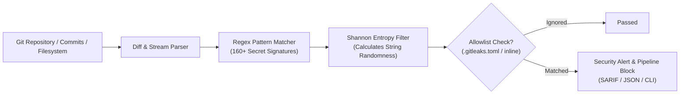

> 🔗 **GitHub Repository**: [gitleaks/gitleaks](https://github.com/gitleaks/gitleaks)

---

# 🔍 Gitleaks

> **Fast, open-source Static Application Security Testing (SAST) tool and pre-commit hook engine for finding hardcoded secrets in code.** Scans git repositories, commits, and directories for exposed passwords, API tokens, AWS keys, and certificates before they reach production.

[](https://opensource.org/licenses/MIT)
[](https://github.com/gitleaks/gitleaks)
[](https://go.dev)
[](#-core-capabilities)

---

## 🚀 Overview

Accidental credential exposure is one of the most frequent vectors for cloud security breaches. Once an API key, database password, or private key is committed to Git history, it must be treated as permanently compromised.

**Gitleaks** is the industry-standard open-source secrets detector written in Go. It performs regex pattern matching and Shannon entropy calculations across past commits, branch diffs, and staged changes to intercept secret leaks at development time and inside CI/CD pipelines.

---

## ⚡ Core Capabilities

| Capability | Description |
|---|---|
| **Full Commit History Audits** | Scans every commit, tag, and stash across the entire lifecycle of a git repository. |
| **Pre-Commit Enforcement** | Blocks accidental commits locally before `git push` transmits secrets to remote remotes. |
| **160+ Built-in Rules** | Out-of-the-box detection for AWS, GitHub, Stripe, Slack, OpenAI, Google Cloud, and database credentials. |
| **Entropy & Regex Hybrid** | Combines regex signature matching with Shannon entropy checks to detect high-randomness secret strings. |
| **CI/CD Integration** | First-class GitHub Action, GitLab CI, and pre-commit framework support with SARIF/JSON reporting. |

---

## 🏗️ Detection Pipeline



---

## 📦 Installation & Setup

### Package Managers

```bash
# macOS / Linux (Homebrew)
brew install gitleaks

# Windows (Scoop / Chocolatey)
scoop install gitleaks
choco install gitleaks

# Docker
docker pull zricethezav/gitleaks:latest

# Go Install
go install github.com/gitleaks/gitleaks/v8@latest
```

---

## 💻 Essential CLI Commands

```bash
# Scan current repository uncommitted working tree
gitleaks detect --verbose

# Scan entire git commit history
gitleaks detect --source . --verbose

# Scan staged changes only (ideal for pre-commit)
gitleaks protect --staged --verbose

# Scan unpushed commits
gitleaks protect --verbose

# Export report in SARIF format for GitHub Security Tab
gitleaks detect --report-format sarif --report-path gitleaks-report.sarif
```

---

## ⚙️ Configuration (`.gitleaks.toml`)

Customize rules and suppress false positives via `.gitleaks.toml` in your repository root:

```toml
[extend]
useDefault = true

[allowlist]
description = "Global allowlist for test fixtures and mock data"
paths = [
    '''tests/fixtures/.*''',
    '''mocks/.*'''
]
regexes = [
    '''dummy-api-key-[0-9a-f]{16}''',
]

# Inline exception comment in code:
# const testKey = "sk_live_12345"; // gitleaks:allow
```

---

## 🤖 Pre-Commit Hook Integration

Add to `.pre-commit-config.yaml`:

```yaml
repos:
  - repo: https://github.com/gitleaks/gitleaks
    rev: v8.24.0
    hooks:
      - id: gitleaks
```

---

## 🔗 Official Links

- **GitHub Repository**: [gitleaks/gitleaks](https://github.com/gitleaks/gitleaks)
- **Author**: [Zachary Rice (@zricethezav)](https://github.com/zricethezav)
- **Official Documentation**: [gitleaks.io](https://gitleaks.io)

---

*← Back to [Developer Tools](./README.md) · [GitHub Repos Hub](../README.md) · [Root Index](../../README.md)*
