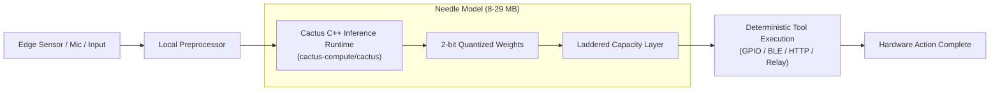

> 🔗 **GitHub Repository**: [cactus-compute/needle](https://github.com/cactus-compute/needle)

---

# 🪡 Needle

> **Ultra-compact automation foundation model for tiny and edge devices.** Engineered by Cactus Compute to bring on-device function calling, automatic speech recognition (ASR), structured data extraction, and localized device control to hardware with as little as 8 MB to 29 MB of RAM.

[](https://opensource.org/licenses/MIT)
[](https://github.com/cactus-compute/needle)
[](#-model-capacity-matrix)
[](https://github.com/cactus-compute/cactus)

---

## 🚀 Overview

Running automation and agentic models traditionally demands gigabytes of VRAM and high-wattage GPUs. For smart home appliances, wearables, robotics, automotive controllers, and resource-constrained edge microcontrollers, cloud connectivity introduces latency, costs, and privacy vulnerabilities.

**Needle** is an open-source family of automation SLMs (Small Language Models) purpose-built for extreme edge environments. Utilizing Cactus Quants (aggressive 2-bit quantization) and laddered sub-network architectures, Needle fits complete function-calling and voice-command capabilities into tiny memory footprints ranging from **8 MB to 29 MB**.

---

## ⚡ Model Capacity Matrix

| Model Tier | Memory Footprint | Quantization | Primary Target Hardware | Capabilities |
|---|---|---|---|---|
| **Needle Nano** | **~8 MB** | 2-bit Cactus Quant | ESP32-S3, Cortex-M, Smart Hubs | Binary routing, basic tool selection, wake commands |
| **Needle Micro** | **~14 MB** | 2-bit / 3-bit mixed | Raspberry Pi Zero, Wearables | Multi-turn function calling, regex extraction |
| **Needle Standard** | **~29 MB** | 2-bit / 4-bit | Mobile (iOS/Android), Automotive | ASR speech-to-intent, structured JSON parsing, localized agent loop |

---

## 🏛️ Edge Architecture



---

## 📦 Installation & Setup

Needle pairs with the **Cactus C++ inference runtime** for cross-platform edge execution:

### 1. Python SDK Installation

```bash
pip install cactus-needle
```

### 2. C++ Edge Compilation (Embedded / Mobile)

```bash
git clone https://github.com/cactus-compute/needle.git
cd needle
mkdir build && cd build
cmake .. -DENABLE_EDGE_OPTIMIZATIONS=ON
make -j4
```

---

## 💻 Usage Examples

### On-Device Function Calling (Python)

```python
from needle import NeedleModel

# Load the ultra-light 14MB model
model = NeedleModel.load("needle-micro-2bit")

# Define available device tools
tools = [
    {
        "name": "adjust_thermostat",
        "parameters": {"temperature": "int", "unit": "str"}
    },
    {
        "name": "toggle_light",
        "parameters": {"room": "str", "state": "bool"}
    }
]

# Run local inference without network connection
result = model.infer(
    prompt="Set the living room temperature to 72 degrees Fahrenheit",
    tools=tools
)

print(result)
# Output: {"tool": "adjust_thermostat", "parameters": {"temperature": 72, "unit": "F"}}
```

---

## 🔑 Key Features

- **Extreme Quantization**: Novel 2-bit weight representations developed specifically for deterministic tool calling and command extraction.
- **Microsecond Latency**: Avoids network hops, executing tool resolution in under 15ms on low-power ARM architectures.
- **Total Privacy & Air-Gap Compliance**: No voice or telemetry packets ever leave the physical device.
- **Deterministic JSON**: Eliminates syntax errors in generated tool parameters through grammar-constrained decoding.

---

## 🔗 Official Links

- **GitHub Repository**: [cactus-compute/needle](https://github.com/cactus-compute/needle)
- **Runtime Engine**: [cactus-compute/cactus](https://github.com/cactus-compute/cactus)
- **Official Website**: [cactuscompute.com](https://cactuscompute.com)

---

*← Back to [Developer Tools](./README.md) · [GitHub Repos Hub](../README.md) · [Root Index](../../README.md)*
