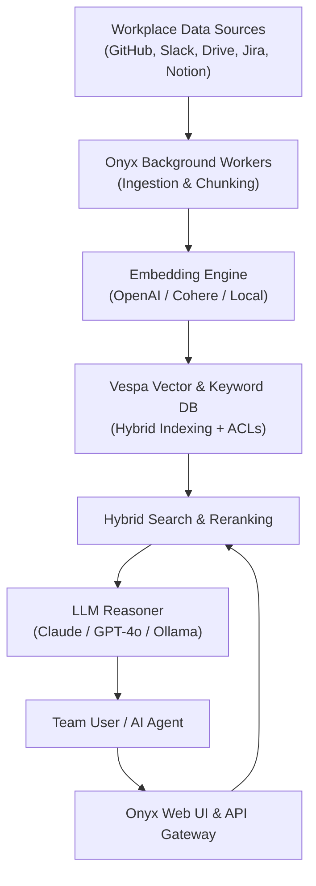

> 🔗 **GitHub Repository**: [onyx-dot-app/onyx](https://github.com/onyx-dot-app/onyx)

---

# 💎 Onyx

> **The open-source GenAI platform and self-hosted workplace knowledge engine.** Formerly known as Danswer, Onyx connects all internal tools, documentation, codebases, and team chats to LLMs via enterprise Retrieval-Augmented Generation (RAG) and customizable autonomous agents.

[](https://opensource.org/licenses/MIT)
[](https://github.com/onyx-dot-app/onyx)
[](https://docs.onyx.app)
[](https://onyx.app)
[](https://github.com/onyx-dot-app/onyx)

---

## 🚀 Overview

Companies have knowledge fragmented across dozens of cloud services: GitHub repositories, Slack channels, Notion wikis, Google Drive folders, Jira boards, and Zendesk tickets. Engineering teams and AI agents need unified, permission-aware access to this data without exposing sensitive credentials to third parties.

**Onyx** (formerly Danswer) is a self-hostable, production-ready AI platform. It indexes disparate workplace knowledge bases, enforces granular document permissions, and provides both a ChatGPT-like team interface and an API/MCP server for AI agents.

---

## ⚡ Core Capabilities

- **50+ Prebuilt Data Connectors**: Ingests and continuously synchronizes data from GitHub, Slack, Google Drive, Notion, Confluence, Jira, Linear, Salesforce, HubSpot, Zendesk, PostgreSQL, Web crawlers, and local file storage.
- **Enterprise-Grade RAG Pipeline**: Combines dense semantic vector embeddings, BM25 keyword matching, cross-encoder rerankers, and chunk deduplication.
- **Document-Level Permissions & RBAC**: Mirrors source platform ACLs (e.g., private Google Drive files or restricted Slack channels are only visible to authorized query users).
- **Multi-LLM & Multi-Embedding Support**:
  - Cloud Providers: OpenAI, Anthropic Claude, Google Gemini, AWS Bedrock, Azure OpenAI.
  - Local & Self-Hosted: Ollama, vLLM, HuggingFace Local Embeddings.
- **Agentic Workflows**: Custom agent personas with tool-calling capabilities (web search, calculator, custom REST endpoints, code execution).
- **Slack & Teams Bot**: Ask questions directly within team communication channels with inline source citations.

---

## 📐 Architecture Overview



---

## 📦 Quickstart Deployment

### Using Docker Compose

```bash
# 1. Clone repository
git clone https://github.com/onyx-dot-app/onyx.git
cd onyx/deployment/docker_compose

# 2. Configure environment (optional custom model keys)
cp env.template .env

# 3. Launch the full stack (Web, Backend, Vespa, Redis, Postgres)
docker compose -f docker-compose.dev.yml -p onyx-stack up -d --build
```

Access the Onyx interface at `http://localhost:3000`.

### Production Kubernetes (Helm)

```bash
helm repo add onyx https://onyx-dot-app.github.io/onyx-helm
helm install onyx onyx/onyx -f values.yaml
```

---

## 💻 Developer API & Agent Context Layer

Onyx exposes standard REST endpoints and MCP servers allowing external AI coding agents to search company context:

```bash
# Query the Onyx RAG search API
curl -X POST "http://localhost:8080/api/direct-qa" \
  -H "Authorization: Bearer $ONYX_API_KEY" \
  -H "Content-Type: application/json" \
  -d '{
    "query": "Where is the authentication token refreshed in the backend?",
    "collection": "engineering-docs"
  }'
```

---

## 🔗 Official Links

- **GitHub Repository**: [onyx-dot-app/onyx](https://github.com/onyx-dot-app/onyx)
- **Official Website**: [onyx.app](https://onyx.app)
- **Documentation**: [docs.onyx.app](https://docs.onyx.app)

---

*← Back to [Developer Tools](./README.md) · [GitHub Repos Hub](../README.md) · [Root Index](../../README.md)*
