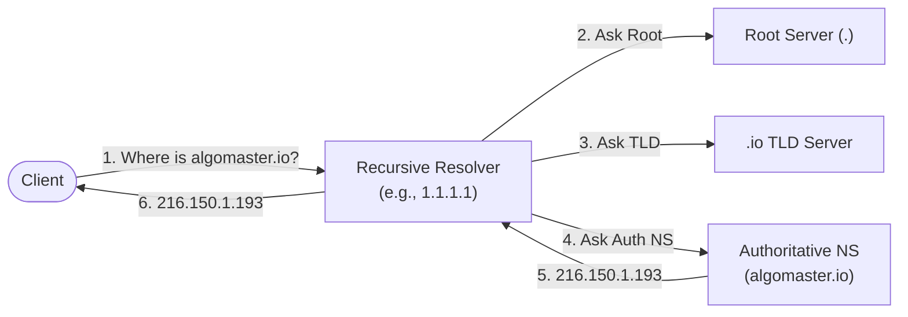
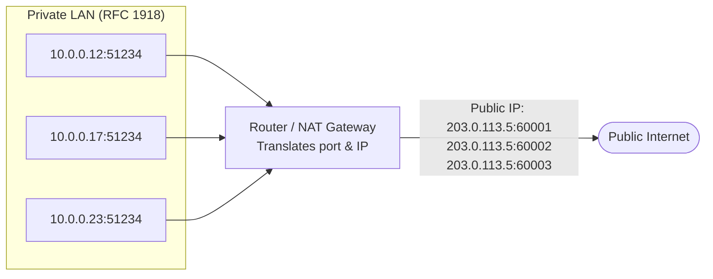
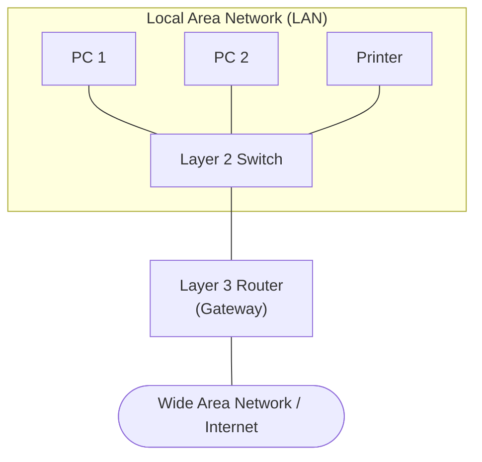
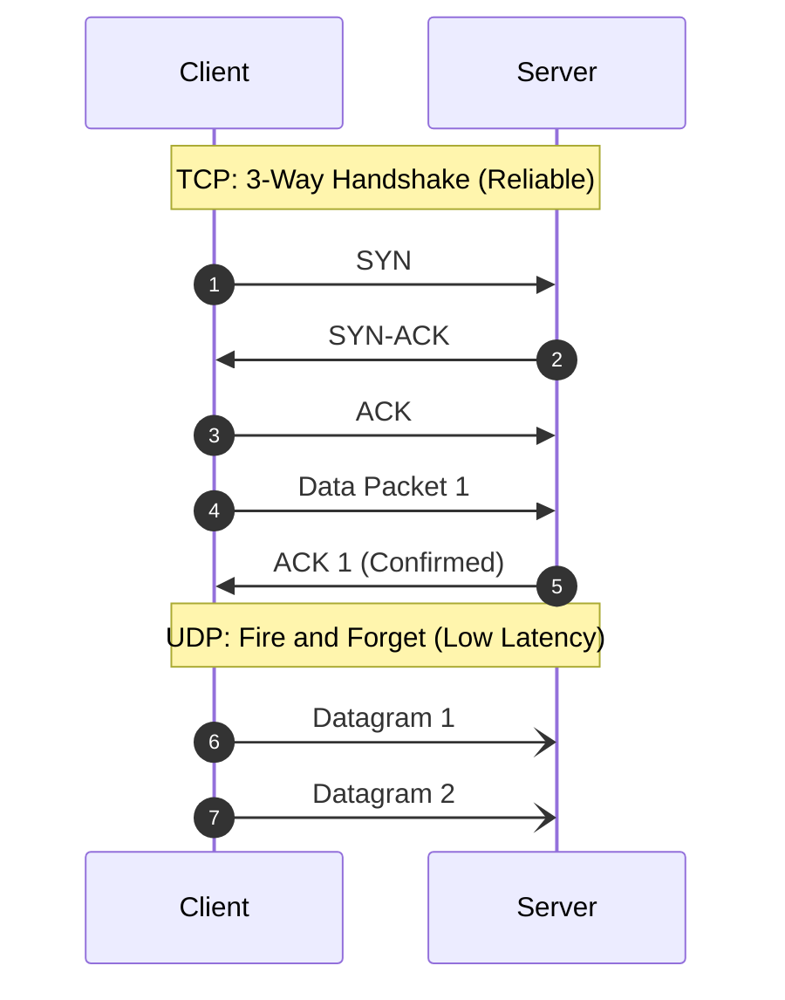
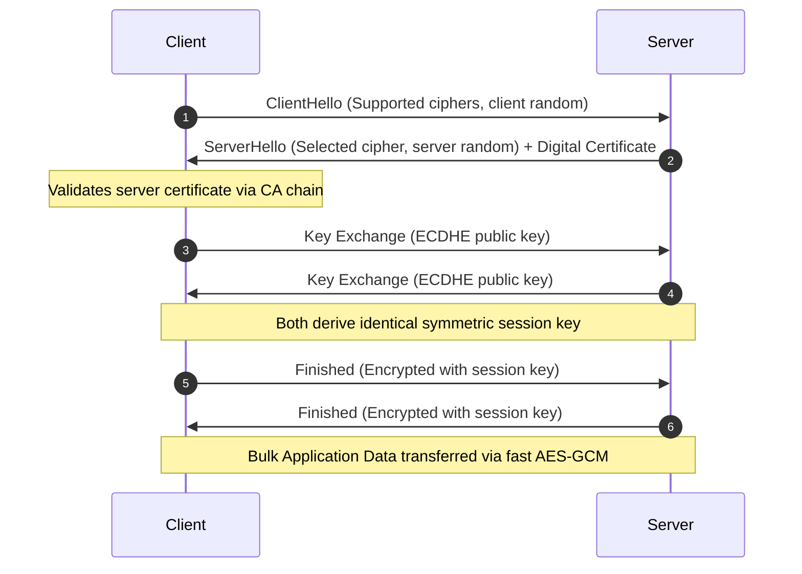
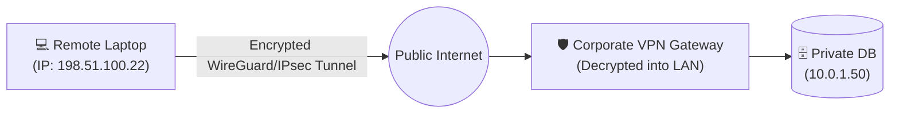

# 🌐 15 Must-Know Networking Concepts

> **Category**: `networking` · **Last Updated**: `2026-10-25` · **Difficulty**: `Beginner to Intermediate`

---

## TL;DR

Computer networking enables distributed systems, APIs, cloud infrastructure, and the internet to communicate. These **15 foundational networking concepts** span addressing, protocols, security, and hardware—from physical wires to encrypted web applications.

```
Device (MAC / IP) ──▶ Switch (LAN) ──▶ Router (NAT / Gateway) ──▶ Internet (DNS / BGP) ──▶ Server (Port / TLS / HTTP)
```

---

## 📋 Quick-Reference Index

| # | Concept | Layer | Core Idea (Infographic Summary) | Primary Protocol / Example |
|---|---|---|---|---|
| 1 | [IP Address](#1-ip-address) | Layer 3 | **Every device gets an address**: Logical network identifier | `192.168.1.4`, `2001:db8::1` |
| 2 | [DNS](#2-dns-domain-name-system) | Layer 7 | **Names resolve to IP addresses**: Internet telephone book | `algomaster.io` → `216.150.1.193` |
| 3 | [Ports](#3-ports) | Layer 4 | **One machine, many services**: Multiplexing traffic to processes | `:80` (HTTP), `:443` (HTTPS), `:22` (SSH) |
| 4 | [MAC Address](#4-mac-address) | Layer 2 | **The NIC's hardware identity**: Physical device address | `3C:22:FB:9A:41:D7` |
| 5 | [NAT](#5-nat-network-address-translation) | Layer 3/4 | **Many private IPs, one public IP**: Conserves IPv4 addresses | `10.0.0.12` → `203.0.113.5:54321` |
| 6 | [DHCP](#6-dhcp-dynamic-host-configuration-protocol) | Layer 7 | **Hands new devices their IP**: Automated network configuration | DORA (`Discover, Offer, Request, Ack`) |
| 7 | [Packets](#7-packets) | Layer 3 | **Data travels in small chunks**: Discrete data units with headers | Header + Payload (MTU ~1500 bytes) |
| 8 | [OSI Model](#8-osi-model) | Layers 1–7 | **Seven layers from app to wire**: Standard networking reference | App → Pres → Sess → Trans → Net → Link → Phys |
| 9 | [Subnetting & CIDR](#9-subnetting--cidr) | Layer 3 | **Split networks into subnets**: IP partitioning and routing blocks | `192.168.1.0/24` (256 IPs), `/28` (16 IPs) |
| 10 | [Router vs Switch](#10-router-vs-switch) | Layer 3 vs 2 | **Between networks vs within one**: Traffic forwarding scope | Switch = Local LAN; Router = Inter-network |
| 11 | [TCP vs UDP](#11-tcp-vs-udp) | Layer 4 | **Reliable stream vs fast datagrams**: Transport reliability choices | TCP = Guaranteed & Ordered; UDP = Fast & Loss-tolerant |
| 12 | [HTTP / HTTPS](#12-http--https) | Layer 7 | **The web, with or without a lock**: Plaintext vs encrypted transfer | `http://` (:80) vs `https://` (:443) |
| 13 | [TLS](#13-tls-transport-layer-security) | Layer 6/7 | **Handshake to encrypt traffic**: Cryptographic session security | ClientHello → Cert → Key Exchange → Encrypted session |
| 14 | [Firewall](#14-firewall) | Layers 3–7 | **Allow the good, block the bad**: Traffic filtering and rule enforcement | Allow `:443`, Drop `:23` (Telnet) |
| 15 | [VPN](#15-vpn-virtual-private-network) | Layers 3–4 | **A private tunnel over the internet**: Encrypted overlay network | WireGuard, OpenVPN, IPsec |

---

## 1. IP Address

### Core Idea: *Every device gets an address*
An **Internet Protocol (IP) address** is a unique logical numerical label assigned to every device connected to a computer network participating in IP communication.

```
       [ Router Gateway: 192.168.1.1 ]
         ├── Laptop:     192.168.1.4
         ├── Smartphone: 192.168.1.7
         └── Server:     192.168.1.9
```

- **IPv4**: 32-bit address represented as 4 decimal octets separated by dots (e.g., `192.168.1.1`). Total pool: ~4.3 billion addresses.
- **IPv6**: 128-bit address written as 8 groups of 4 hexadecimal digits separated by colons (e.g., `2001:0db8:85a3:0000:0000:8a2e:0370:7334`). Provides $3.4 \times 10^{38}$ unique addresses.
- **Private IP Ranges (RFC 1918)**: Unroutable on the public internet, reserved for local networks:
  - `10.0.0.0` – `10.255.255.255` (`10.0.0.0/8`)
  - `172.16.0.0` – `172.31.255.255` (`172.16.0.0/12`)
  - `192.168.0.0` – `192.168.255.255` (`192.168.0.0/16`)
- **Loopback**: `127.0.0.1` (`localhost` in IPv4) and `::1` (IPv6).

---

## 2. DNS (Domain Name System)

### Core Idea: *Names resolve to IP addresses*
DNS is the hierarchical, distributed phonebook of the internet. It maps human-friendly hostnames to machine-readable IP addresses.



### Essential DNS Record Types
- **A**: Maps a hostname to an IPv4 address (`example.com` → `93.184.216.34`).
- **AAAA**: Maps a hostname to an IPv6 address (`example.com` → `2606:2800:220:1:248:1893:25c8:1946`).
- **CNAME**: Canonical name alias pointing one domain to another (`www.example.com` → `example.com`).
- **MX**: Mail Exchange record directing email to mail servers.
- **TXT**: Arbitrary text attributes; widely used for SPF, DKIM, and domain ownership verification.
- **NS**: Identifies the authoritative nameservers for a zone.

```bash
# Query DNS records from the terminal
dig A algomaster.io +short
```

---

## 3. Ports

### Core Idea: *One machine, many services*
While an IP address directs traffic to a specific host, a **Port** (a 16-bit number ranging from `0` to `65535`) directs data to a specific application or process running on that host.

```
                   ┌── :80  ──▶ Web Server (HTTP)
[ Host: 10.0.0.5 ] ├── :443 ──▶ Secure Web Server (HTTPS)
                   └── :22  ──▶ SSH Daemon
```

### Port Categories
| Range | Category | Purpose & Standard Services |
|---|---|---|
| **0 – 1023** | Well-Known | Privileged system services: `20/21` (FTP), `22` (SSH), `25` (SMTP), `53` (DNS), `80` (HTTP), `443` (HTTPS). |
| **1024 – 49151** | Registered | Vendor/user services: `3000` (Dev web), `3306` (MySQL), `5432` (PostgreSQL), `6379` (Redis), `8080` (HTTP Proxy). |
| **49152 – 65535** | Dynamic / Ephemeral | Temporary ports automatically assigned to client-side outbound connections. |

---

## 4. MAC Address

### Core Idea: *The NIC's hardware identity*
A **Media Access Control (MAC) address** is a permanent, 48-bit physical identifier burned into a Network Interface Card (NIC) at the factory, formatted as 6 hexadecimal octets:

```
  3C : 22 : FB  :  9A : 41 : D7
  └─── OUI ───┘    └── Device ID ──┘
 (Vendor: Apple)    (Unique Serial)
```

- **Scope**: Local Area Network (Layer 2) communication only. MAC addresses never leave the local subnet or cross routers.
- **ARP (Address Resolution Protocol)**: Dynamically resolves a known Layer 3 IP address to its corresponding Layer 2 MAC address on the local network (`arp -a`).

---

## 5. NAT (Network Address Translation)

### Core Idea: *Many private IPs, one public IP*
NAT allows an entire private local network (LAN) containing dozens or hundreds of devices to share a single public IP address when connecting to the internet, preserving IPv4 address space.



- **PAT (Port Address Translation / NAT Overload)**: Assigns each internal connection a unique ephemeral port on the public IP.
- **DNAT (Port Forwarding)**: Directs incoming requests on specific public ports to internal private server IPs.

---

## 6. DHCP (Dynamic Host Configuration Protocol)

### Core Idea: *Hands new devices their IP*
When a new device connects to Wi-Fi or Ethernet, DHCP automatically assigns it an IP address, subnet mask, default gateway, and DNS servers through the **DORA** handshake:

```
Client                                      DHCP Server
  │                                              │
  │─── 1. Discover (Broadcast: Who is DHCP?) ───▶│
  │◀── 2. Offer    (Here is IP: 192.168.1.15) ───│
  │─── 3. Request  (I accept IP: 192.168.1.15) ─▶│
  │◀── 4. Ack      (Confirmed! Lease: 24h) ──────│
```

---

## 7. Packets

### Core Idea: *Data travels in small chunks*
Data transmitted across networks is split into small units called **Packets** (Layer 3) or **Frames** (Layer 2), transmitted independently, and reassembled at the destination.

```
┌─────────────────────────────────────────────────────────────┐
│                       IP Packet                             │
├───────────────────────────────┬─────────────────────────────┤
│      Header (20–60 bytes)     │     Payload (Data Chunk)    │
│  - Source IP      - Dest IP   │                             │
│  - TTL (Hop limit)- Protocol  │    Application Data bytes   │
│  - Packet Length  - Checksum  │                             │
└───────────────────────────────┴─────────────────────────────┘
```

- **MTU (Maximum Transmission Unit)**: The maximum packet size supported by a link (standard Ethernet MTU is **1500 bytes**).
- **Fragmentation**: Large payloads exceeding the MTU are broken into smaller packets and reconstructed via sequence numbers.

---

## 8. OSI Model

### Core Idea: *Seven layers from app to wire*
The Open Systems Interconnection (OSI) 7-layer model standardizes network communication functions into decoupled layers:

| Layer | Name | Function | PDU | Protocols / Hardware |
|---|---|---|---|---|
| **7** | **Application** | User-facing network interfaces and applications | Data | HTTP, HTTPS, DNS, SSH, FTP, SMTP |
| **6** | **Presentation** | Data formatting, compression, and TLS/SSL encryption | Data | TLS, JSON, XML, JPEG, UTF-8 |
| **5** | **Session** | Establishes, manages, and terminates connections | Data | NetBIOS, RPC, Sockets, Named Pipes |
| **4** | **Transport** | End-to-end delivery, reliability, and port multiplexing | Segment | TCP, UDP |
| **3** | **Network** | Routing across diverse networks and logical addressing | Packet | IP (IPv4/IPv6), ICMP, Routers |
| **2** | **Data Link** | Node-to-node framing and physical addressing | Frame | Ethernet, Wi-Fi, MAC addresses, Switches |
| **1** | **Physical** | Bitstream transmission across physical mediums | Bits | Copper cables, Fiber optics, Radio waves |

> **Mnemonic**: *(Bottom-to-Top)* **P**lease **D**o **N**ot **T**hrow **S**ausage **P**izza **A**way.

---

## 9. Subnetting & CIDR

### Core Idea: *Split networks into subnets*
**Classless Inter-Domain Routing (CIDR)** partitions IP address blocks into logical subnets. The prefix (e.g., `/24`) defines how many bits belong to the **Network** versus the **Host**:

```
CIDR: 192.168.1.0/28 (32 bits total)

[ 11000000 . 10101000 . 00000001 . 0000 ] [ 0000 ]
└──────────────── 28 bits (Network) ─────┘ └── 4 bits (Host) ──┘
                                               2^4 = 16 IP addresses
                                               (14 usable hosts)
```

| CIDR Prefix | Subnet Mask | Total IPs | Usable Hosts | Common Use |
|---|---|---|---|---|
| `/32` | `255.255.255.255` | 1 | 1 (Single Host) | Point-to-point / Host route |
| `/30` | `255.255.255.252` | 4 | 2 | Router-to-router links |
| `/28` | `255.255.255.240` | 16 | 14 | Small microservice subnets |
| `/24` | `255.255.255.0` | 256 | 254 | Standard office / home LAN |
| `/16` | `255.255.0.0` | 65,536 | 65,534 | Cloud VPCs (AWS / GCP / Azure) |

*(Note: In every subnet, 2 IPs are reserved: the **Network ID** (first address) and the **Broadcast Address** (last address)).*

---

## 10. Router vs. Switch

### Core Idea: *Between networks vs. within one*



| Feature | Switch (Layer 2) | Router (Layer 3) |
|---|---|---|
| **Primary Scope** | Connects devices **within the same network** (LAN) | Connects **multiple distinct networks** (LAN to WAN) |
| **Addressing Used** | MAC Addresses | IP Addresses |
| **Data Unit** | Frames | Packets |
| **Routing Decisions** | MAC lookup table | IP Routing Table + BGP / OSPF |
| **Broadcast Domain** | Single broadcast domain (without VLANs) | Breaks up broadcast domains |

---

## 11. TCP vs. UDP

### Core Idea: *Reliable stream vs. fast datagrams*



| Attribute | TCP (Transmission Control Protocol) | UDP (User Datagram Protocol) |
|---|---|---|
| **Connection** | Connection-oriented (3-way handshake) | Connectionless (no handshake) |
| **Reliability** | Guaranteed delivery (retransmits lost packets) | No guarantee (dropped packets are ignored) |
| **Ordering** | In-order reassembly | Out-of-order delivery possible |
| **Speed / Overhead** | Higher overhead (20-byte header, ACKs) | Extremely lightweight (8-byte header, zero ACKs) |
| **Flow Control** | Yes (sliding window & congestion avoidance) | None |
| **Best Used For** | Web (HTTP/1.1 & 2), Databases, SSH, File transfer | Video streaming, DNS, VoIP, Online multiplayer gaming |

---

## 12. HTTP / HTTPS

### Core Idea: *The web, with or without a lock*
**Hypertext Transfer Protocol (HTTP)** is the foundation of data communication on the World Wide Web.

```
HTTP (Port 80):   [ Client ] ──────── Plaintext (Unencrypted) ───────▶ [ Server ]
                                  (Vulnerable to snooping & MITM)

HTTPS (Port 443):  [ Client ] ═══ Encrypted TLS Tunnel (Confidential) ═══▶ [ Server ]
                                  (Authentic, Private, Tamper-proof)
```

- **HTTP/1.1**: Persistent connections, sequential requests (head-of-line blocking).
- **HTTP/2**: Binary framing, multiplexed streams over a single TCP connection, header compression (HPACK).
- **HTTP/3**: Runs over **QUIC** (UDP-based), eliminating TCP head-of-line blocking and speeding up connection handshakes.

---

## 13. TLS (Transport Layer Security)

### Core Idea: *Handshake to encrypt traffic*
TLS (the successor to SSL) provides privacy, authenticity, and data integrity over untrusted networks.



- **Asymmetric Encryption**: Used only during the handshake to verify identity and securely exchange keys without sharing secrets.
- **Symmetric Encryption**: Used for bulk data transmission because it is orders of magnitude faster.

---

## 14. Firewall

### Core Idea: *Allow the good, block the bad*
A **Firewall** monitors and filters incoming and outgoing network traffic based on predefined security access control lists (ACLs).

```
Incoming Traffic
  ├── :443 (HTTPS)  ──▶ [ Allowed: Web Server ]
  ├── :22  (SSH)    ──▶ [ Filtered: VPN IPs Only ]
  └── :23  (Telnet) ──▶ [ 🚫 BLOCKED / DROPPED ]
```

### Firewall Types
- **Packet-Filtering (Stateless)**: Inspects individual packets in isolation based on Source/Dest IP and Port.
- **Stateful Inspection**: Tracks active connection states (e.g., permits inbound traffic only if it matches an established outbound request).
- **Web Application Firewall (WAF)**: Inspects Layer 7 application payloads for SQL injection, XSS, and malicious payloads.

```bash
# Allow HTTPS and block unencrypted Telnet via UFW
sudo ufw allow 443/tcp
sudo ufw deny 23/tcp
```

---

## 15. VPN (Virtual Private Network)

### Core Idea: *A private tunnel over the internet*
A **VPN** creates an encrypted virtual point-to-point tunnel across an insecure public network (the internet), extending a private network securely.



- **Encapsulation**: Encloses standard packets inside an outer encrypted packet payload.
- **Modern Protocols**:
  - **WireGuard**: Fast, modern, minimal codebase (~4,000 lines), uses state-of-the-art cryptography (ChaCha20, Curve25519).
  - **OpenVPN**: Highly configurable, works over TCP and UDP.
  - **IPsec / IKEv2**: Robust protocol suite standard on mobile devices and enterprise site-to-site tunnels.

---

## 🔗 Related Topics

- [Security — OWASP Top 10](../security/owasp-top-10.md)
- [Architecture — Backend Architecture](../architecture/backend-architecture.md)
- [Architecture — AI Agent Patterns](../architecture/ai-agent-patterns.md)

---

*← Back to [Networking README](./README.md) · [Root Index](../README.md)*
