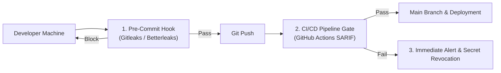

# 🛡️ Secret Scanning & Credential Protection

> **Category**: `security` · **Last Updated**: `2026-10-22` · **Difficulty**: `Beginner to Intermediate`

---

## TL;DR

Hardcoded secrets (API tokens, private keys, database passwords) committed to Git repositories represent one of the most common causes of data breaches. Implement automated secret scanning locally via pre-commit hooks and centrally within CI/CD pipelines to prevent leaks before code reaches remote repositories.

---

## 📋 Overview

Once a secret is committed to a git repository, even if removed in a subsequent commit, it remains permanently accessible in the commit history and reflog. Public git repositories are monitored by automated bots that scrape and exploit leaked credentials within seconds.

- **What**: Automated static analysis tools that inspect file contents, diffs, and commit histories for credential patterns and high-entropy strings.
- **Why**: Prevent catastrophic API abuse, data exfiltration, cloud account compromise, and compliance violations.
- **When**: In pre-commit hooks, pull request CI/CD gates, continuous artifact auditing, and historical codebase migrations.

---

## 🔑 Defense-in-Depth Pipeline



---

## 🛠️ Recommended Secret Scanning Tools

| Tool | Engine | Key Strengths | Upstream Reference |
|---|---|---|---|
| **Betterleaks** | BPE Tokenization (`cl100k_base`) | Low false positives, live token verification, recursive archive decoding | [Betterleaks Cheat Sheet](../github_repos/developer-tools/betterleaks.md) |
| **Gitleaks** | Regex + Shannon Entropy | Industry standard, 160+ built-in rules, mature pre-commit ecosystem | [Gitleaks Cheat Sheet](../github_repos/developer-tools/gitleaks.md) |
| **GitHub Secret Scanning** | Push Protection | Native to GitHub Enterprise & Public Repos, partner token revoking | [GitHub Security](https://docs.github.com/en/code-security/secret-scanning) |

---

## ⚙️ Quick Start: Setting Up Pre-Commit Protection

### 1. Install Pre-Commit Framework

```bash
pip install pre-commit
```

### 2. Configure `.pre-commit-config.yaml`

```yaml
repos:
  - repo: https://github.com/gitleaks/gitleaks
    rev: v8.24.0
    hooks:
      - id: gitleaks
```

### 3. Install Git Hook

```bash
pre-commit install
```

Every `git commit` command now scans staged changes before committing.

---

## 🚨 Incident Response: What to Do When a Secret Leaks

If a credential was committed and pushed:

1. **Rotate Immediately**: Invalidate the key in the provider dashboard (AWS, Stripe, OpenAI). Do not simply delete the line from code.
2. **Audit Access Logs**: Check cloud provider access logs for unauthorized actions taken using the compromised credential.
3. **Purge Git History**: Use tools like `git-filter-repo` or BFG Repo-Cleaner if the history must be cleaned:
   ```bash
   git filter-repo --invert-paths --path path/to/leaked-config.env
   ```
4. **Force-Push & Notify**: Update all team clones and re-issue credentials via environment variables or secret managers (e.g., Vault, AWS Secrets Manager).

---

## ⚠️ Anti-Patterns vs. Best Practices

| ❌ Anti-Pattern | ✅ Best Practice |
|---|---|
| Committing `.env` files into source control | Adding `.env*` to `.gitignore` and committing `.env.example` templates |
| Reverting a commit to "hide" an exposed API key | Rotating and revoking the key immediately at the provider |
| Hardcoding test keys in unit tests | Mocking credentials or using scoped, dummy sandbox credentials |
| Disabling secret scanning because of false positives | Refining `.gitleaks.toml` allowlists or switching to BPE-based Betterleaks |

---

## 🔗 Related Resources

- [OWASP Top 10 Guide](owasp-top-10.md) — Fundamental web application security risks.
- [Gitleaks Developer Reference](../github_repos/developer-tools/gitleaks.md)
- [Betterleaks Developer Reference](../github_repos/developer-tools/betterleaks.md)

---

*← Back to [Security](./README.md) · [Root Index](../README.md)*
