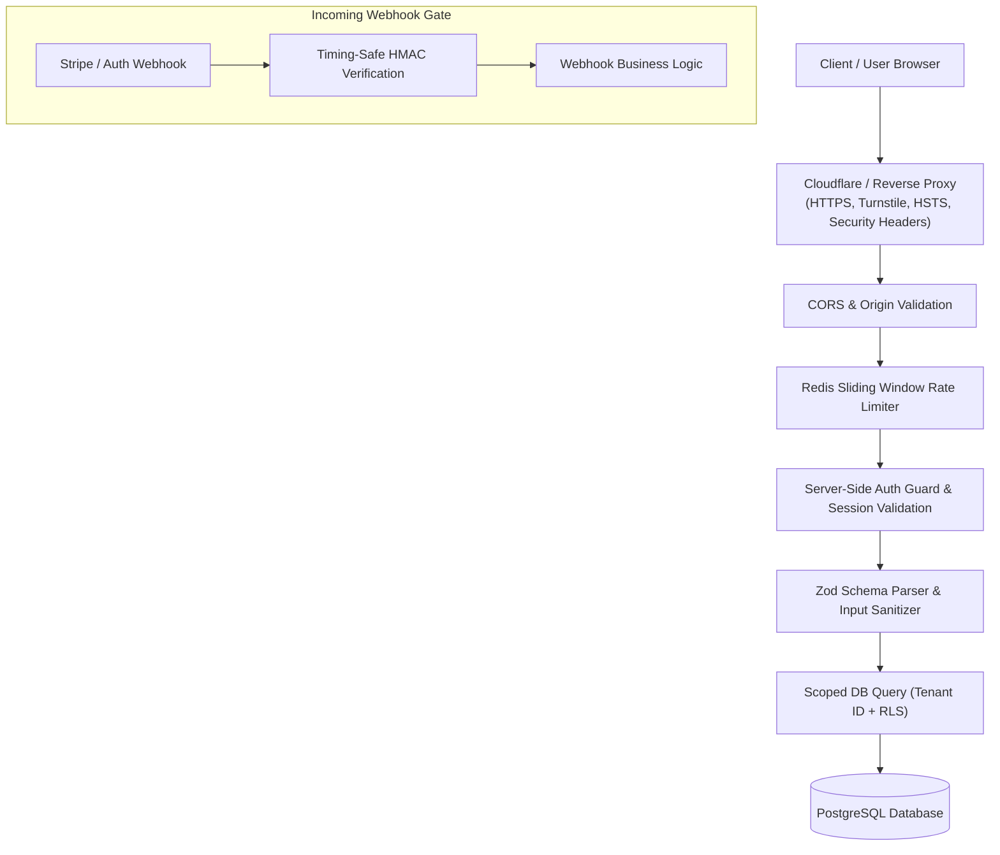

# 🛡️ 19 Security Holes to Close on Your Vibe-Coded SaaS App

> **Category**: `security` · **Last Updated**: `2026-10-22` · **Difficulty**: `Intermediate`

---

## TL;DR

AI code generators and rapid "vibe coding" can spin up functional SaaS applications in hours, but models often omit critical defensive layers like Row Level Security, server-side route guards, strict input sanitization, and timing-safe webhook verification. Close these 19 foundational security vulnerabilities before launching to production.

---

## 📋 Overview

When shipping fast with AI assistants (Claude Code, Cursor, Codex), models prioritize the "happy path" that gets the UI working quickly. Security controls—such as authorization checks on nested API routes, private storage bucket permissions, and timing-safe cryptographic comparisons—are frequently overlooked.

- **What**: A comprehensive 19-point hardening checklist tailored for modern full-stack SaaS apps (Next.js, Supabase, Node, FastAPI, PostgreSQL).
- **Why**: Prevent catastrophic data leaks, unauthorized tenant access, credit card abuse, and remote code execution.
- **When**: Audit this checklist during the MVP-to-production hardening phase before onboarding paying customers.

---

## 🔑 The 19 Vulnerabilities Checklist

| # | Security Vulnerability | Threat Category | Primary Risk | Mitigation Target |
|---|---|---|---|---|
| 1 | **Row Level Security (RLS)** | Broken Access Control | Tenant data leakage | PostgreSQL / Supabase RLS policies |
| 2 | **Auth on Every API Route** | Broken Authentication | Unauthenticated endpoint access | Middleware & route-level session validation |
| 3 | **Never Trust the Frontend** | Security Misconfiguration | Parameter tampering / price manipulation | Server-side validation of all state & authority |
| 4 | **Rate Limiting** | Denial of Service & Abuse | Brute force, scraping, API quota exhaustion | Redis sliding-window / token bucket rate limiters |
| 5 | **Sanitize User Input** | Injection & XSS | Cross-Site Scripting (XSS), script injection | DOMPurify, schema validators (Zod), encoding |
| 6 | **Parameterized Queries** | SQL Injection | Database dump or unauthorized data modification | Prepared statements, ORM parameterization |
| 7 | **Lock Down CORS** | Broken Access Control | Unauthorized cross-origin resource requests | Whitelist specific frontend domains, no `*` with credentials |
| 8 | **HTTPS Everywhere** | Sensitive Data Exposure | Man-in-the-Middle (MitM) sniffing | TLS 1.3, HSTS header, automatic HTTP redirect |
| 9 | **Stop IDOR Bugs** | Insecure Direct Object Ref | Accessing records by guessing integer/UUID IDs | Scoping queries by authenticated `user_id` / `org_id` |
| 10 | **Debug Mode Off in Prod** | Information Disclosure | Exposing stack traces, environment vars & secrets | Set `NODE_ENV=production`, hide verbose error traces |
| 11 | **CAPTCHA on Public Forms** | Automated Abuse | Bot account spam, credential stuffing | Cloudflare Turnstile / reCAPTCHA on public forms |
| 12 | **Log Admin Actions** | Audit & Accountability | Insider threats & untracked administrative tampering | Immutable audit logging of privileged operations |
| 13 | **Private Storage Buckets** | Unrestricted Resource Access | Direct URL scraping of private user uploads | S3 / GCS private ACLs + short-lived signed URLs |
| 14 | **Hide Admin Pages Properly** | Broken Authorization | Bypassing UI-only client-side redirects | Server-side authentication gates on server components/routes |
| 15 | **Update Vulnerable Packages** | Known Vulnerabilities | Supply chain attacks & CVE exploitation | Automated `npm audit`, Dependabot, Renovate |
| 16 | **Check File Upload Types** | Malicious File Upload | Web shells, SVG XSS, zip slip attacks | Magic bytes inspection, random filenames, size caps |
| 17 | **Claude / AI Security Review** | Human / Agent Blindspots | Logic flaws introduced during vibe coding | Automated multi-agent security audit prompts |
| 18 | **Security Headers** | Browser-Side Exploits | Clickjacking, MIME sniffing, downgrade attacks | Strict CSP, HSTS, X-Frame-Options, Permissions-Policy |
| 19 | **Verify Webhook Signatures** | Impersonation / Forgery | Faking Stripe payment success or auth callbacks | Timing-safe HMAC signature verification on raw bytes |

---

## 🛠️ The 19 Security Controls: Deep Dive & Code Patterns

### 1. Row Level Security (RLS)

AI coding tools often generate tables without enabling PostgreSQL Row Level Security, allowing anyone with an API key to read all rows via postgREST / Supabase.

```sql
-- ❌ INSECURE: Table created with open access
CREATE TABLE projects (id UUID PRIMARY KEY, user_id UUID, data TEXT);

-- ✅ SECURE: Enable RLS and restrict rows to the authenticated owner
ALTER TABLE projects ENABLE ROW LEVEL SECURITY;

CREATE POLICY "Users can only read own projects"
ON projects FOR SELECT
USING (auth.uid() = user_id);

CREATE POLICY "Users can only modify own projects"
ON projects FOR ALL
USING (auth.uid() = user_id);
```

---

### 2. Auth on Every API Route

Do not rely solely on top-level layout checks or global frontend route wrappers. Explicitly verify user identity in every route handler.

```typescript
// ✅ Next.js App Router (app/api/data/route.ts)
import { getServerSession } from "next-auth";
import { authOptions } from "@/lib/auth";

export async function GET(req: Request) {
  const session = await getServerSession(authOptions);
  if (!session?.user?.id) {
    return new Response(JSON.stringify({ error: "Unauthorized" }), { status: 401 });
  }
  // Proceed with authorized logic...
}
```

---

### 3. Never Trust the Frontend

Never accept client-supplied role flags, plan tiers, or item prices in request bodies.

```typescript
// ❌ INSECURE: Accepting price or role from client payload
const { planId, price, isAdmin } = await req.json();

// ✅ SECURE: Fetch authoritative price and role from database/Stripe
const { planId } = await req.json();
const authoritativePlan = await db.plans.findUnique({ where: { id: planId } });
const priceToCharge = authoritativePlan.amountInCents;
```

---

### 4. Rate Limiting

Protect public endpoints (auth, reset password, webhook targets, LLM generation) with Redis sliding-window rate limiters.

```typescript
import { Ratelimit } from "@upstash/ratelimit";
import { Redis } from "@upstash/redis";

const ratelimit = new Ratelimit({
  redis: Redis.fromEnv(),
  limiter: Ratelimit.slidingWindow(5, "60 s"), // 5 requests per minute
});

export async function POST(req: Request) {
  const ip = req.headers.get("x-forwarded-for") ?? "anonymous";
  const { success } = await ratelimit.limit(ip);
  if (!success) {
    return new Response("Too Many Requests", { status: 429 });
  }
  // Process request...
}
```

---

### 5. Sanitize User Input

Always validate schemas and sanitize any user-provided HTML before rendering it to prevent stored XSS.

```typescript
import { z } from "zod";
import DOMPurify from "isomorphic-dompurify";

const PostSchema = z.object({
  title: z.string().min(1).max(100),
  content: z.string().max(5000)
});

// Parse and purify
const data = PostSchema.parse(await req.json());
const sanitizedContent = DOMPurify.sanitize(data.content);
```

---

### 6. Parameterized Queries

Never concatenate untrusted input into raw SQL queries.

```typescript
// ❌ INSECURE: Vulnerable to SQL injection
await db.$queryRawUnsafe(`SELECT * FROM users WHERE email = '${email}'`);

// ✅ SECURE: Parameterized query (or standard ORM findUnique)
await db.$queryRaw`SELECT * FROM users WHERE email = ${email}`;
```

---

### 7. Lock Down CORS

Never use `Access-Control-Allow-Origin: *` on endpoints that accept credentials, cookies, or auth headers.

```typescript
const ALLOWED_ORIGINS = ["https://app.yourdomain.com", "https://yourdomain.com"];

export function middleware(req: Request) {
  const origin = req.headers.get("origin");
  if (origin && ALLOWED_ORIGINS.includes(origin)) {
    return new Response(null, {
      headers: {
        "Access-Control-Allow-Origin": origin,
        "Access-Control-Allow-Credentials": "true",
        "Access-Control-Allow-Methods": "GET,POST,PUT,DELETE,OPTIONS"
      }
    });
  }
}
```

---

### 8. HTTPS Everywhere

Force TLS 1.3 and enforce HSTS (`Strict-Transport-Security`) to prevent man-in-the-middle downgrade attacks.

```text
Strict-Transport-Security: max-age=63072000; includeSubDomains; preload
```

Configure your reverse proxy (Cloudflare, Nginx, Vercel) to redirect all port 80 HTTP traffic to port 443 HTTPS automatically.

---

### 9. Stop IDOR (Insecure Direct Object Reference) Bugs

Always scope database lookups to the currently authenticated user's organization or account ID.

```typescript
// ❌ INSECURE: Fetching record by ID alone (any user can access any invoice)
const invoice = await db.invoice.findUnique({ where: { id: params.invoiceId } });

// ✅ SECURE: Scoped to authenticated user/tenant
const invoice = await db.invoice.findFirst({
  where: {
    id: params.invoiceId,
    organizationId: session.user.orgId // Enforces ownership boundary
  }
});
if (!invoice) return new Response("Not Found", { status: 404 });
```

---

### 10. Debug Mode Off in Production

Ensure stack traces, development banners, and environment configs are disabled in production builds.

```javascript
// next.config.js / server config
if (process.env.NODE_ENV === "production") {
  // Ensure source maps are not exposed publicly unless behind authenticated VPN
  productionBrowserSourceMaps: false
}
```

Never return raw database or runtime errors (`err.stack`) in API response JSON payloads. Return generic error messages with an internal correlation ID.

---

### 11. CAPTCHA on Public Forms

Protect registration, login, contact, and checkout forms from credential-stuffing bots and spam.

- Use invisible, privacy-conscious solutions like **Cloudflare Turnstile** or **hCaptcha**.
- Validate the Turnstile challenge token server-side before executing expensive database or AI API calls.

---

### 12. Log Admin Actions (Audit Trail)

Record every privileged operation (role changes, user impersonations, billing overrides, data exports) in an append-only audit table.

```typescript
await db.auditLog.create({
  data: {
    actorId: session.user.id,
    action: "USER_ROLE_UPDATED",
    targetId: targetUser.id,
    ipAddress: req.headers.get("x-forwarded-for"),
    metadata: { previousRole: "member", newRole: "admin" }
  }
});
```

---

### 13. Private Storage Buckets

Do not leave AWS S3, Google Cloud Storage, or Supabase Storage buckets set to public read.

- Set storage bucket ACLs to **private**.
- Serve sensitive files (documents, exports, invoices) via short-lived **presigned URLs** (e.g., 5-minute expiry).

```typescript
// S3 Presigned URL Example
const command = new GetObjectCommand({ Bucket: "user-assets", Key: fileKey });
const signedUrl = await getSignedUrl(s3Client, command, { expiresIn: 300 });
```

---

### 14. Hide Admin Pages Properly

Hiding a link in a React sidebar is not security. Ensure server components and layout loaders verify administrative roles before rendering.

```typescript
// app/admin/layout.tsx (Server Component)
export default async function AdminLayout({ children }: { children: React.ReactNode }) {
  const session = await getServerSession(authOptions);
  
  if (session?.user?.role !== "ADMIN") {
    redirect("/dashboard"); // Redirect on the server before sending admin bundle
  }
  
  return <section>{children}</section>;
}
```

---

### 15. Update Vulnerable Packages

Automate vulnerability detection with continuous scanning:

```bash
# Run vulnerability audit locally
npm audit --omit=dev

# Fix automatic patchable CVEs
npm audit fix
```

Enable GitHub **Dependabot** alerts and automated PR updates in `.github/dependabot.yml`.

---

### 16. Check File Upload Types

Never rely solely on the file extension or MIME type sent in the request header (`req.headers["content-type"]`). Attackers easily rename `.php` or `.html` to `.png`.

1. Inspect **magic bytes** (file signature) using libraries like `file-type`.
2. Generate a random UUID filename (e.g., `crypto.randomUUID() + ".png"`).
3. Restrict max file size (e.g., 5 MB limit).
4. Do not store uploaded user files in the web root where they can be executed by the web server.

---

### 17. Claude / AI Security Review

Before shipping AI-generated code, conduct an explicit adversarial review pass using your AI coding assistant:

```text
# Prompt to run in Claude Code / Antigravity / Cursor:
"Perform an adversarial security audit on this module. 
Check for:
1. IDOR and unauthorized tenant data access
2. Unhandled edge cases and missing authorization checks
3. Dangerous unparameterized queries or string interpolations
4. Missing rate limits or unvalidated user inputs
Report all findings with severity ratings and specific remediation diffs."
```

---

### 18. Security Headers

Configure robust HTTP security headers in your reverse proxy or framework middleware:

```typescript
// next.config.mjs or middleware.ts
const securityHeaders = [
  { key: "X-Frame-Options", value: "DENY" }, // Prevents clickjacking
  { key: "X-Content-Type-Options", value: "nosniff" }, // Blocks MIME confusion
  { key: "Referrer-Policy", value: "strict-origin-when-cross-origin" },
  { key: "Permissions-Policy", value: "camera=(), microphone=(), geolocation=()" },
  { 
    key: "Content-Security-Policy", 
    value: "default-src 'self'; script-src 'self' 'unsafe-inline'; img-src 'self' data: https:;" 
  }
];
```

---

### 19. Verify Webhook Signatures

Never process incoming webhooks (e.g., Stripe, Polar, Clerk, GitHub) based on the JSON payload alone. Verify the HMAC signature using the raw unparsed request body and a timing-safe equality check.

```typescript
// Stripe Webhook Verification Example (Next.js App Router)
import Stripe from "stripe";

const stripe = new Stripe(process.env.STRIPE_SECRET_KEY!);

export async function POST(req: Request) {
  const rawBody = await req.text(); // Must read as raw text, NOT req.json()
  const sig = req.headers.get("stripe-signature");

  try {
    const event = stripe.webhooks.constructEvent(
      rawBody,
      sig!,
      process.env.STRIPE_WEBHOOK_SECRET!
    );
    // Signature verified; proceed with event handling
  } catch (err: any) {
    return new Response(`Webhook Error: ${err.message}`, { status: 400 });
  }
}
```

---

## 🏛️ Comprehensive Defense Architecture



---

## 🔗 Related Resources

- [OWASP Top 10 Reference](owasp-top-10.md) — Canonical web application vulnerabilities.
- [Secret Scanning & Credential Protection](secret-scanning.md) — Pre-commit protection with Gitleaks & Betterleaks.
- [Claude Code Best Practice](../github_repos/ai-agents-skills/claude-code-best-practice.md) — Agentic engineering guidelines.

---

*← Back to [Security](./README.md) · [Root Index](../README.md)*
