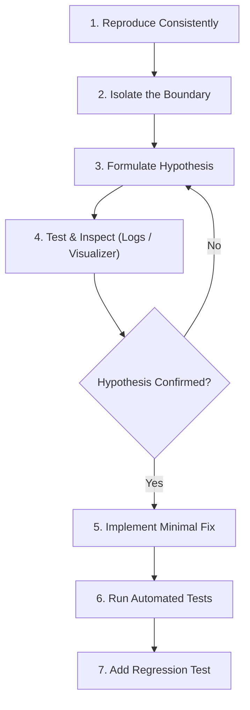

# 🐛 Interactive Debugging Platforms

> **Category**: `testing` · **Last Updated**: `2026-10-22` · **Difficulty**: `Beginner to Intermediate`

---

## TL;DR

Instead of passively watching endless video tutorials, build real software troubleshooting muscle memory with interactive debugging websites. Learn to isolate errors, analyze stack traces, inspect runtime memory, and fix broken code across Python, JavaScript, and React.

---

## 📋 Overview

Debugging is often cited as taking up over 50% of professional software engineering time, yet traditional education rarely teaches it systematically. Interactive debugging playgrounds bridge this gap by placing developers inside broken codebases with realistic failure modes, test runners, and memory inspectors.

- **What**: Interactive platforms providing broken code challenges, runtime visualizers, and simulation environments.
- **Why**: Passive tutorials create the illusion of competence; active bug hunting develops mental models for root cause analysis and diagnosis.
- **When**: Preparing for technical interviews, transitioning from syntax syntax-learning to real-world engineering, or mastering tricky asynchronous and memory concepts.

---

## 🏆 Featured Debugging Platforms

| # | Platform | Best For | Supported Languages | Link |
|---|---|---|---|---|
| 🥇 1 | **BugHunt** | **Beginners & Core Problem Solving** | Python, JavaScript | [trybughunt.com](https://trybughunt.com) |
| 🥈 2 | **Python Tutor** | **Visual Memory & Execution Debugging** | Python, Java, C, C++, JavaScript | [pythontutor.com](https://pythontutor.com) |
| 🥉 3 | **Buglyst** | **Real-World Codebases & Test Failures** | Multi-language / Full-stack | [buglyst.com](https://buglyst.com) |
| 🏅 4 | **Bug Dojo** | **Frontend & React State/Lifecycle Debugging** | React, JavaScript, TypeScript | [thebugdojo.com](https://thebugdojo.com) |

---

## 🔍 Platform Deep Dives

### 🥇 1. BugHunt — Best for Beginners

🔗 **Website**: [trybughunt.com](https://trybughunt.com)

BugHunt presents curated snippets of buggy code with broken logic, off-by-one errors, or improper data manipulations. Users must diagnose what is wrong, patch the snippet, and pass the integrated test suite.

- ✅ **Practice debugging Python & JavaScript** without complex environment setup.
- ✅ **Find and fix bugs in broken code** with immediate test validation feedback.
- ✅ **Test your solutions** against automated edge-case test runners.
- ✅ **Improve problem-solving skills** by developing diagnostic intuition.

---

### 🥈 2. Python Tutor — Best for Visual Debugging

🔗 **Website**: [pythontutor.com](https://pythontutor.com)

Created by Philip Guo, Python Tutor has helped millions of students visually step through over 200 million pieces of code. It renders dynamic memory diagrams showing stack frames, heap objects, pointer references, and variable scopes at each execution step.

- ✅ **Execute code line by line** with forward and backward execution stepping.
- ✅ **Visualize variables and memory** (stack frames, object allocations, reference graphs).
- ✅ **Understand recursion, pointers, and data structures** visually without guesswork.
- ✅ **Supports Python, Java, C, C++, and JavaScript**.

---

### 🥉 3. Buglyst — Best for Real-World Debugging

🔗 **Website**: [buglyst.com](https://buglyst.com)

Moving beyond single-file puzzles, Buglyst simulates real-world developer workflows. You are dropped into realistic multi-file repositories with failing CI/CD test runs, production logs, and error stack traces.

- ✅ **Debug realistic codebases** structured like production projects.
- ✅ **Investigate failing tests** and trace regressions through multiple modules.
- ✅ **Analyze logs and error messages** to diagnose intermittent and edge-case errors.
- ✅ **Practice diagnosing software issues** just like on-call production engineers.

---

### 🏅 4. Bug Dojo — Best for React Debugging

🔗 **Website**: [thebugdojo.com](https://thebugdojo.com)

Frontend bugs often involve subtle reactivity issues: stale closures in `useEffect`, unmemoized callbacks causing infinite renders, mutated state objects, or missing cleanup functions. Bug Dojo specializes in fixing broken UI components.

- ✅ **Debug broken React components** and faulty UI interactions.
- ✅ **Find common JavaScript & React mistakes** (stale closures, race conditions, hydration mismatches).
- ✅ **Practice frontend debugging** using real browser rendering and simulated user clicks.
- ✅ **Improve your React skills** and master state management principles.

---

## 📐 The Systematic Debugging Method

---

## ⚠️ Debugging Anti-Patterns vs. Best Practices

| ❌ Anti-Pattern | ✅ Better Approach |
|---|---|
| **Shotgun Debugging**: Randomly changing code hoping it works | Formulate a specific hypothesis based on logs and test one change at a time |
| **Ignoring the Stack Trace**: Skipping error messages to guess the issue | Read stack traces from bottom to top; identify the exact line of failure |
| **Fixing Symptoms, Not Causes**: Adding `if (val != null)` to hide null pointers | Trace where the unexpected null originated and correct the root data flow |
| **No Regression Test**: Fixing a bug without adding a test case | Write a reproducing test that fails before the fix and passes after |

---

## 🔗 Related Resources

- [Unit Testing Guide](unit-testing.md) — Fundamental unit testing concepts and the Arrange-Act-Assert pattern.
- [Free Tools Hub](../tools/free/README.md) — Additional free developer tools and utilities.

---

*← Back to [Testing](./README.md) · [Root Index](../README.md)*
